# System Design Specification (SDS)

---

**SENG 31242 – Software Engineering**

**University of Kelaniya**

---

| Field          | Detail                                          |
| -------------- | ----------------------------------------------- |
| Document Title | System Design Specification                     |
| Project Name   | stackstorm (Dickwella Fashion Corner – Online Clothing Shop) |
| Created Date   | 2026/03/31                                      |
| Last Updated   | 2026/04/27                                      |
| Version No     | 02                                              |

---

**Version History**

| Version | Date       | Author(s)           | Summary of Changes     |
| ------- | ---------- | ------------------- | ---------------------- |
| 01      | 2026/03/31 | [Team Member Names] | Initial SDS draft      |
| 02      | 2026/04/27 | Amarawickrama R.H., S. Thanoogithan, B.K. Pabasara, Lakshani A.T. | Synchronised with SRS changes (naming, formatting, table numbering) |

---

**List of Figures**

| Figure No. | Caption                                                  | Page |
| ---------- | -------------------------------------------------------- | ---- |
| Figure 1   | High-Level Layered Architecture Diagram                  |      |
| Figure 2   | Cloud-Native Architecture Diagram                        |      |
| Figure 3   | Entity-Relationship (ER) Diagram                         |      |
| Figure 4   | Class Diagram – Core Domain Model                        |      |
| Figure 5   | Sequence Diagram – Customer Registration                 |      |
| Figure 6   | Sequence Diagram – Product Search and Filtering          |      |
| Figure 7   | Sequence Diagram – Add to Cart and Checkout              |      |
| Figure 8   | Sequence Diagram – Order Tracking                        |      |
| Figure 9   | Sequence Diagram – Process Return and Refund             |      |
| Figure 10  | Sequence Diagram – Manage Inventory                      |      |
| Figure 11  | Wireframe – Customer Homepage                            |      |
| Figure 12  | Wireframe – Product Listing Page                         |      |
| Figure 13  | Wireframe – Product Detail Page                          |      |
| Figure 14  | Wireframe – Shopping Cart and Checkout                   |      |
| Figure 15  | Wireframe – Admin Dashboard                              |      |
| Figure 16  | User Flow / Navigation Diagram                           |      |
| Figure 17  | Security Architecture Diagram                            |      |
| Figure 18  | Deployment Architecture Diagram                          |      |
| Figure 19  | CI/CD Pipeline Overview Diagram                          |      |

**List of Tables**

| Table No. | Caption                                          | Page |
| --------- | ------------------------------------------------ | ---- |
| Table 1   | Technology Stack Summary                         |      |
| Table 2   | Database Normalisation Summary                   |      |
| Table 3   | Class Attributes and Methods Summary             |      |
| Table 4   | UI Accessibility Compliance Checklist            |      |
| Table 5   | Authentication and Authorisation Levels          |      |
| Table 6   | Encryption Standards Summary                     |      |
| Table 7   | Hardware Requirements                            |      |
| Table 8   | Environment Specification                        |      |

---

**Table of Contents**

1. Architectural Design
   - 1.1 High-level architecture
   - 1.2 Cloud-native architecture
   - 1.3 Justification for architecture choice
   - 1.4 Scalability and maintainability considerations
2. Database Design
   - 2.1 Entity-Relationship diagram
   - 2.2 Normalisation explanation
3. Class Diagram
   - 3.1 Core domain classes
   - 3.2 Class relationships and multiplicity
4. Sequence Diagrams
   - 4.1 Customer registration
   - 4.2 Product search and filtering
   - 4.3 Add to cart and checkout
   - 4.4 Order tracking
   - 4.5 Process return and refund
   - 4.6 Manage inventory
5. UI/UX Design
   - 5.1 Wireframes and screen mock-ups
   - 5.2 User flow and navigation diagrams
   - 5.3 Accessibility considerations
6. Security Design
   - 6.1 Authentication mechanism
   - 6.2 Authorisation levels
   - 6.3 Data protection approach
   - 6.4 Input validation and sanitisation strategy
   - 6.5 Encryption standards
7. Deployment Design
   - 7.1 Hosting plan
   - 7.2 Hardware requirements
   - 7.3 Environment specification
   - 7.4 CI/CD pipeline overview
8. References

---

---

# **CHAPTER 1: ARCHITECTURAL DESIGN**

This chapter describes the overall system architecture adopted for the Dickwella Fashion Corner platform, the justification for the architectural decisions made, and the measures taken to ensure scalability and maintainability.

## 1.1 High-level architecture

A **Layered (N-Tier) Architecture combined with the MVC pattern** has been adopted for the stackstorm system. The architecture is organised into the following four tiers:

**Presentation Layer (View):**
The presentation layer is responsible for rendering the user interface in the client's web browser. It is implemented using React.js, a component-based JavaScript library, and communicates with the backend exclusively through RESTful API calls. This layer handles client-side routing, form validation, state management, and responsive rendering across devices ranging from 320px to 2560px screen widths.

**Application Layer (Controller):**
The application layer serves as the intermediary between the presentation layer and the business logic layer. It is implemented using Node.js with the Express.js framework. This layer receives HTTP requests, performs request validation, invokes the appropriate business logic services, and returns JSON responses. RESTful API endpoints are organised by domain (e.g., `/api/products`, `/api/orders`, `/api/customers`).

**Business Logic Layer (Model/Service):**
The business logic layer encapsulates the core domain rules and processing logic of the system. It contains service classes responsible for operations such as order processing, inventory management, payment gateway integration, loyalty point calculations, RFM analysis, notification dispatching, and AI chatbot intent resolution. This layer ensures that business rules (e.g., 30-day return window, promotional code validation, loyalty tier thresholds) are enforced consistently.

**Data Access Layer:**
The data access layer manages all interactions with the database. It is implemented using Sequelize ORM for object-relational mapping, providing an abstraction over raw SQL queries. This layer handles CRUD operations, complex queries (e.g., sales aggregation, inventory analytics), database transactions, and connection pooling.

**Figure 1: High-Level Layered Architecture Diagram**

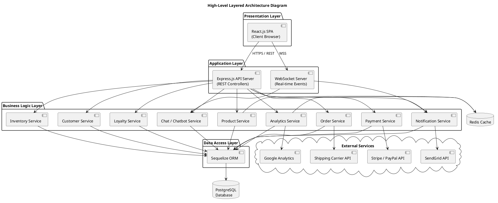

**Table 1: Technology Stack Summary**

| Layer              | Technology                      | Purpose                                             |
| ------------------ | ------------------------------- | --------------------------------------------------- |
| Frontend           | React.js 18+                   | Component-based SPA for customer and admin UIs       |
| State Management   | Redux Toolkit                  | Centralised application state management             |
| Backend Framework  | Node.js 20 LTS + Express.js 4  | RESTful API server and request handling              |
| Real-time          | Socket.IO                      | WebSocket-based real-time communication              |
| ORM                | Sequelize 6                    | Object-relational mapping for database operations    |
| Database           | PostgreSQL 16                  | Primary relational data store                        |
| Cache              | Redis 7                        | Session storage, query caching, rate limiting        |
| Authentication     | JWT + bcrypt                   | Token-based auth and password hashing                |
| Payment Gateway    | Stripe SDK / PayPal SDK        | Payment processing integration                      |
| Email Service      | SendGrid API                   | Transactional and marketing email delivery           |
| File Storage       | AWS S3                         | Product images, invoices, and bulk upload storage    |
| Search             | Elasticsearch (optional)       | Full-text search with fuzzy matching                 |
| Containerisation   | Docker + Docker Compose        | Application containerisation and orchestration       |

## 1.2 Cloud-native architecture

The stackstorm system is designed to be deployed as a cloud-native application leveraging containerisation and managed cloud services.

**Figure 2: Cloud-Native Architecture Diagram**

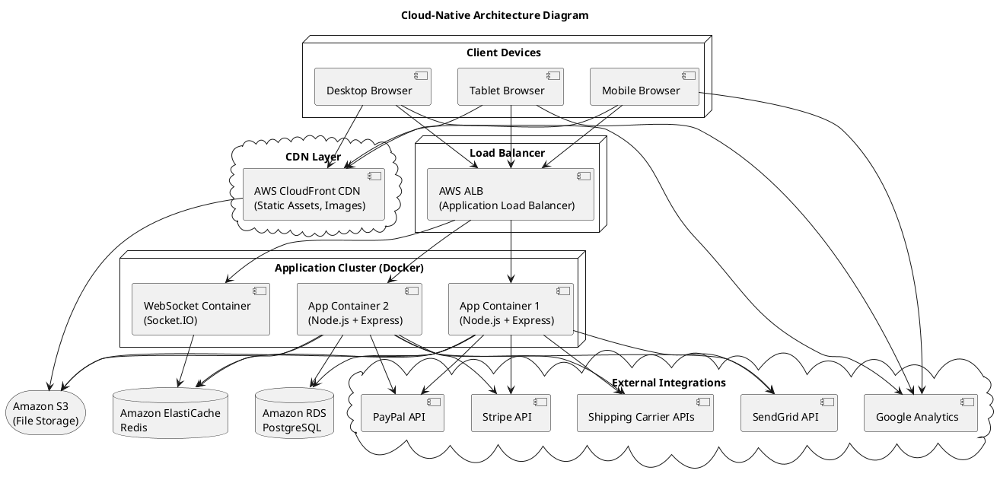

## 1.3 Justification for architecture choice

The Layered (N-Tier) Architecture with MVC pattern was selected for the following reasons:

1. **Separation of Concerns:** Each layer has a distinct responsibility, reducing coupling between the user interface, business logic, and data persistence. This separation enables independent development and testing of each layer.

2. **Team Familiarity:** The development team possesses foundational knowledge of the MVC pattern from coursework. This familiarity reduces the learning curve and accelerates development within the 6–8 month project timeline.

3. **Modularity:** The service-based organisation within the business logic layer (ProductService, OrderService, InventoryService, etc.) allows individual modules to be developed, tested, and updated independently, aligning with the phased delivery approach outlined in the SRS.

4. **Scalability Path:** While a full microservices architecture was considered, it was deemed premature for the current project scope. The layered architecture provides a clear migration path: individual services within the business logic layer can be extracted into standalone microservices in future iterations as the system's load profile evolves.

5. **Rejection of Monolithic Architecture:** A monolithic approach was rejected as it would make deployment of individual module updates require redeployment of the entire system, increasing risk and downtime.

## 1.4 Scalability and maintainability considerations

**Scalability:**

- **Horizontal Scaling:** The stateless design of the application layer (using JWT for authentication and Redis for session storage) enables multiple application containers to run behind a load balancer. The system is designed to support up to 2,000 concurrent users (NFR-014) through horizontal scaling.
- **Database Scaling:** Read replicas may be configured for PostgreSQL to distribute read-heavy queries (product browsing, reporting). Connection pooling via Sequelize is configured with a maximum of 20 connections per container.
- **Caching Strategy:** Redis is employed to cache frequently accessed data such as product listings, category trees, and search results, reducing database load and ensuring sub-2-second response times (NFR-001).
- **CDN Offloading:** Static assets (product images, CSS, JavaScript bundles) are served through AWS CloudFront CDN, reducing latency and server load.

**Maintainability:**

- **Code Organisation:** The codebase follows a modular directory structure organised by feature domain (products, orders, customers, inventory, etc.), enabling developers to locate and modify code efficiently.
- **API Documentation:** All public API endpoints are documented using OpenAPI (Swagger) specification, ensuring at least 50% documentation coverage (NFR-017).
- **Automated Testing:** Unit tests (Jest), integration tests (Supertest), and end-to-end tests are maintained with a target of 50% code coverage. Each module is independently testable with no more than 2 hours of integration testing per module update (NFR-016).
- **Version Control:** Git with a branching strategy (main, develop, feature branches) is used for source code management, enabling collaborative development and code review.
- **Logging and Monitoring:** Structured logging (Winston) and application performance monitoring are implemented across all layers to facilitate debugging and performance analysis.

---

# **CHAPTER 2: DATABASE DESIGN**

This chapter presents the database design for the stackstorm system, including the Entity-Relationship diagram and the normalisation rationale.

## 2.1 Entity-Relationship diagram

The database is implemented using PostgreSQL 16 and comprises the following primary entities and their relationships, as derived from the data requirements specified in the SRS (Chapter 13).

**Figure 3: Entity-Relationship (ER) Diagram**

```plantuml
@startuml
title Entity-Relationship (ER) Diagram
left to right direction
skinparam linetype ortho

entity "CUSTOMER" as CUST {
  * customer_id : int <<PK>>
  --
  * email : varchar <<UK>>
  * hashed_password : varchar
  * name : varchar
  phone : varchar
  registration_date : date
  preferred_size : varchar
  preferred_categories : varchar
  language : varchar
  currency : varchar
  newsletter_subscription : boolean
  loyalty_points : int
  loyalty_tier : varchar
}

entity "ADDRESS" as ADDR {
  * address_id : int <<PK>>
  --
  * customer_id : int <<FK>>
  label : varchar
  street : varchar
  city : varchar
  postal_code : varchar
  country : varchar
  is_default : boolean
}

entity "SAVED_PAYMENT" as SPAY {
  * token_id : int <<PK>>
  --
  * customer_id : int <<FK>>
  card_last_four : varchar
  card_type : varchar
  expiry_date : date
  gateway_token : varchar
}

entity "PRODUCT" as PROD {
  * product_id : int <<PK>>
  --
  * name : varchar
  description : text
  * price : decimal
  material : varchar
  care_instructions : text
  category : varchar
  brand : varchar
}

entity "PRODUCT_VARIANT" as PV {
  * variant_id : int <<PK>>
  --
  * product_id : int <<FK>>
  size : varchar
  colour : varchar
  * sku : varchar <<UK>>
  * stock_quantity : int
  images : text
}

entity "ORDER" as ORD {
  * order_id : int <<PK>>
  --
  * customer_id : int <<FK>>
  * order_date : timestamp
  * status : varchar
  shipping_address : text
  billing_address : text
  payment_token : varchar
  shipping_option : varchar
  shipping_cost : decimal
  tax_amount : decimal
  discount_amount : decimal
  * total_amount : decimal
  tracking_number : varchar
  promo_code_id : int <<FK>>
  notes : text
}

entity "ORDER_ITEM" as OI {
  * order_item_id : int <<PK>>
  --
  * order_id : int <<FK>>
  * variant_id : int <<FK>>
  * quantity : int
  * unit_price : decimal
}

entity "CART" as CART {
  * cart_id : int <<PK>>
  --
  customer_or_session_id : varchar
  created_date : timestamp
}

entity "CART_ITEM" as CI {
  * cart_item_id : int <<PK>>
  --
  * cart_id : int <<FK>>
  * variant_id : int <<FK>>
  * quantity : int
  added_date : timestamp
}

entity "WISHLIST" as WISH {
  * wishlist_id : int <<PK>>
  --
  * customer_id : int <<FK>>
  * product_id : int <<FK>>
  added_date : timestamp
}

entity "REVIEW" as REV {
  * review_id : int <<PK>>
  --
  * product_id : int <<FK>>
  * customer_id : int <<FK>>
  * rating : int
  review_text : text
  review_date : timestamp
  helpful_count : int
  images : text
  verified_purchase : boolean
}

entity "RETURN" as RET {
  * return_id : int <<PK>>
  --
  * order_id : int <<FK>>
  * variant_id : int <<FK>>
  * reason : varchar
  * status : varchar
  refund_amount : decimal
  return_shipping_cost : decimal
  created_date : timestamp
  completed_date : timestamp
}

entity "PROMO_CODE" as PROMO {
  * code_id : int <<PK>>
  --
  * code_string : varchar <<UK>>
  * discount_type : varchar
  * discount_value : decimal
  minimum_purchase : decimal
  valid_from : timestamp
  valid_until : timestamp
  maximum_uses : int
  current_uses : int
  active : boolean
}

entity "LOYALTY" as LOY {
  * customer_id : int <<FK>>
  --
  current_points : int
  lifetime_points : int
  tier : varchar
  tier_start_date : date
  points_expiry_date : date
}

entity "LOYALTY_TRANSACTION" as LT {
  * transaction_id : int <<PK>>
  --
  * customer_id : int <<FK>>
  * points_change : int
  * reason : varchar
  date : timestamp
}

entity "NOTIFICATION" as NOTIF {
  * notification_id : int <<PK>>
  --
  * customer_id : int <<FK>>
  * type : varchar
  template : varchar
  * status : varchar
  created_date : timestamp
  sent_date : timestamp
}

entity "CHAT_SESSION" as CS {
  * session_id : int <<PK>>
  --
  * customer_id : int <<FK>>
  agent_id : int <<FK>>
  start_time : timestamp
  end_time : timestamp
  status : varchar
  satisfaction_rating : int
}

entity "CHAT_MESSAGE" as CM {
  * message_id : int <<PK>>
  --
  * session_id : int <<FK>>
  * sender : varchar
  message_text : text
  timestamp_sent : timestamp
  attachments : text
}

entity "INVENTORY_LOG" as ILOG {
  * log_id : int <<PK>>
  --
  * variant_id : int <<FK>>
  * change_amount : int
  previous_quantity : int
  new_quantity : int
  * reason : varchar
  reference_id : varchar
  timestamp_logged : timestamp
}

' ── Relationships with cardinality ──
CUST ||--o{ ADDR       : "has"
CUST ||--o{ SPAY       : "stores"
CUST ||--o{ ORD        : "places"
CUST ||--o{ WISH       : "maintains"
CUST ||--o{ REV        : "writes"
CUST ||--o{ CART       : "owns"
CUST ||--|| LOY        : "earns"
CUST ||--o{ NOTIF      : "receives"
CUST ||--o{ CS         : "initiates"

PROD ||--o{ PV         : "has"
PROD ||--o{ WISH       : "listed in"
PROD ||--o{ REV        : "receives"

PV   ||--o{ OI         : "ordered as"
PV   ||--o{ CI         : "added to"
PV   ||--o{ ILOG       : "tracked by"
PV   ||--o{ RET        : "returned as"

ORD  ||--o{ OI         : "contains"
ORD  ||--o{ RET        : "has"

CART ||--o{ CI         : "contains"

LOY  ||--o{ LT         : "records"

CS   ||--o{ CM         : "contains"

PROMO ||--o{ ORD       : "applied to"

@enduml
```

## 2.2 Normalisation explanation

The database schema has been designed to conform to the **Third Normal Form (3NF)** to minimise data redundancy and ensure data integrity.

**Table 2: Database Normalisation Summary**

| Normal Form | Requirement                                        | How It Is Satisfied                                                                                                                                                                          |
| ----------- | -------------------------------------------------- | -------------------------------------------------------------------------------------------------------------------------------------------------------------------------------------------- |
| 1NF         | All attributes must contain atomic (indivisible) values; each record must be unique. | Each table has a primary key. Multi-valued attributes (e.g., product images, cart items) are stored in separate related tables rather than as comma-separated values.                         |
| 2NF         | All non-key attributes must be fully functionally dependent on the entire primary key. | Composite dependencies are eliminated. For example, `ORDER_ITEM` stores `unit_price` separately from `PRODUCT_VARIANT.price` to preserve the price at the time of purchase.                  |
| 3NF         | No transitive dependencies; non-key attributes must depend only on the primary key.   | Transitive dependencies are removed. For example, customer loyalty data is stored in a separate `LOYALTY` table rather than within the `CUSTOMER` table, as tier calculations depend on spending totals. |

**Additional design decisions:**

- **Denormalisation for Performance:** The `CUSTOMER` table retains `loyalty_points` and `loyalty_tier` as denormalised fields for display purposes, while the authoritative loyalty data resides in the `LOYALTY` and `LOYALTY_TRANSACTION` tables. This trade-off reduces join operations for frequently accessed customer profile pages.
- **Soft Deletes:** Customer records are not physically deleted upon customer request; instead, a `deleted_at` timestamp is set, allowing compliance with legal retention obligations while honouring deletion requests.
- **Indexing Strategy:** Indexes are created on frequently queried columns, including `CUSTOMER.email`, `PRODUCT_VARIANT.sku`, `ORDER.customer_id`, `ORDER.status`, and `ORDER.order_date`, to ensure that database query response times remain below 500ms for standard CRUD operations (NFR-015).

---

# **CHAPTER 3: CLASS DIAGRAM**

This chapter presents the class diagram for the core domain model of the stackstorm system, detailing attributes, methods, visibility, relationships, and multiplicity.

## 3.1 Core domain classes

**Figure 4: Class Diagram – Core Domain Model**

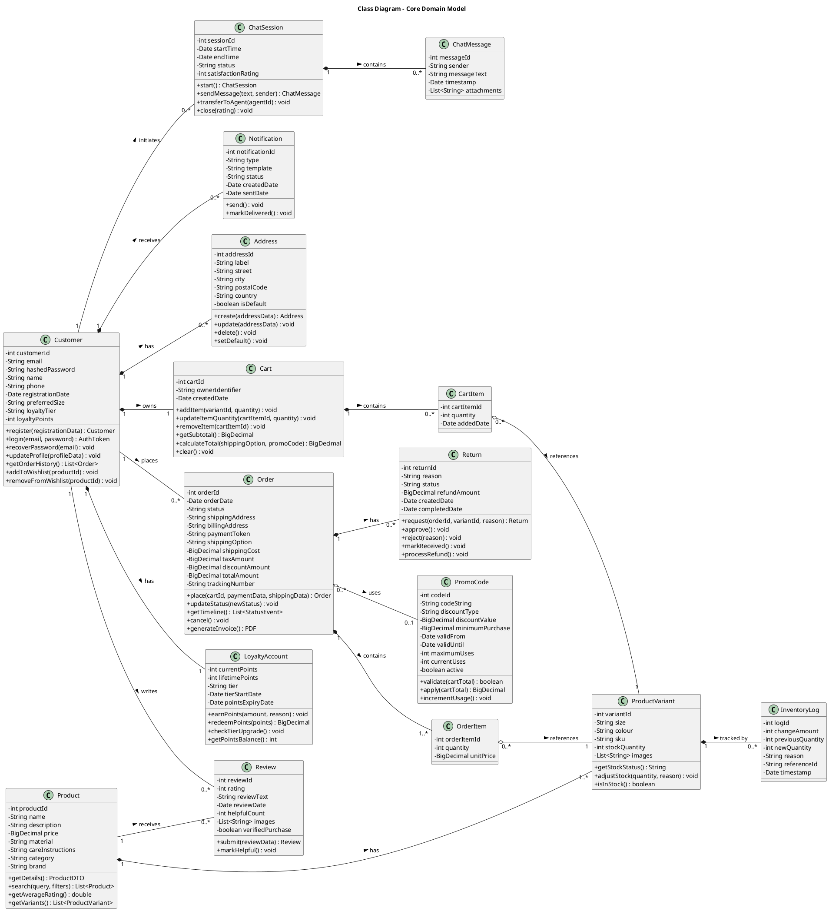

## 3.2 Class relationships and multiplicity

**Table 3: Class Attributes and Methods Summary**

| Relationship                        | Type          | Multiplicity | Description                                                        |
| ----------------------------------- | ------------- | ------------ | ------------------------------------------------------------------ |
| Customer – Address                  | Composition   | 1 to 0..*    | A customer may have zero or more saved addresses.                   |
| Customer – Order                    | Association   | 1 to 0..*    | A customer may place zero or more orders.                           |
| Customer – Cart                     | Composition   | 1 to 1       | Each customer owns exactly one active cart.                         |
| Customer – LoyaltyAccount          | Composition   | 1 to 1       | Each registered customer has exactly one loyalty account.            |
| Customer – Review                   | Association   | 1 to 0..*    | A customer may write zero or more reviews (verified purchases only).|
| Product – ProductVariant            | Composition   | 1 to 1..*    | Each product has at least one variant (size/colour combination).     |
| Product – Review                    | Association   | 1 to 0..*    | Each product may receive zero or more reviews.                      |
| Cart – CartItem                     | Composition   | 1 to 0..*    | A cart contains zero or more cart items.                             |
| Order – OrderItem                   | Composition   | 1 to 1..*    | An order contains at least one order item.                          |
| Order – Return                      | Association   | 1 to 0..*    | An order may have zero or more associated returns.                  |
| Order – PromoCode                   | Association   | 0..* to 0..1 | An order may optionally use one promotional code.                   |
| ChatSession – ChatMessage           | Composition   | 1 to 0..*    | A chat session contains zero or more messages.                      |
| ProductVariant – InventoryLog       | Association   | 1 to 0..*    | Each variant has zero or more inventory change logs.                 |

**Visibility notation:** Private attributes are denoted with `-`, and public methods are denoted with `+`. All domain class attributes are encapsulated as private, with access provided through public getter/setter methods and domain-specific operations.

---

# **CHAPTER 4: SEQUENCE DIAGRAMS**

This chapter presents sequence diagrams for all major use cases identified in the SRS document. Each diagram illustrates the interactions among system components for a given scenario.

## 4.1 Customer registration

**Figure 5: Sequence Diagram – Customer Registration**

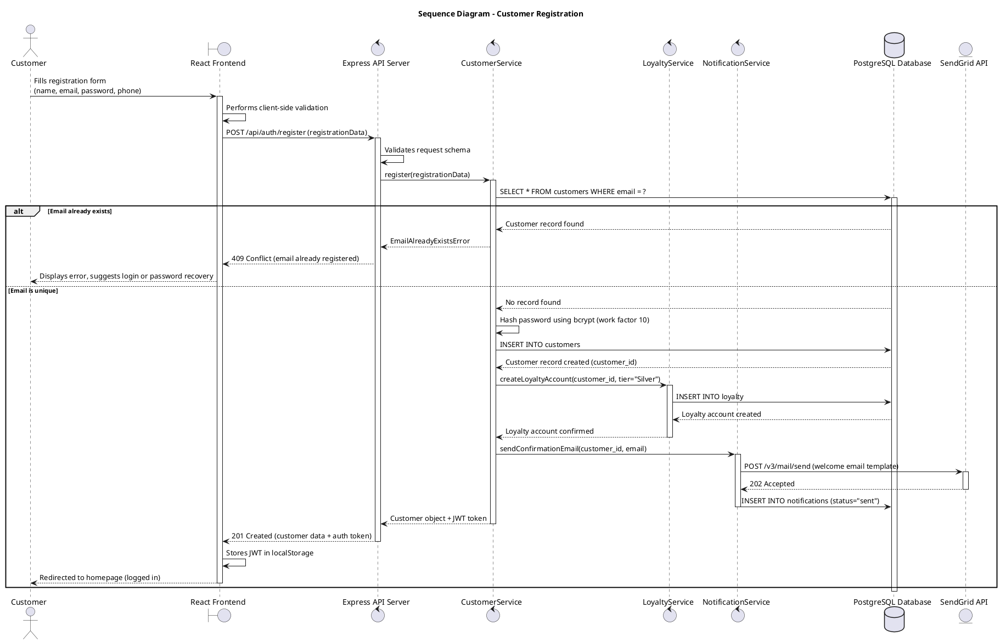

## 4.2 Product search and filtering

**Figure 6: Sequence Diagram – Product Search and Filtering**

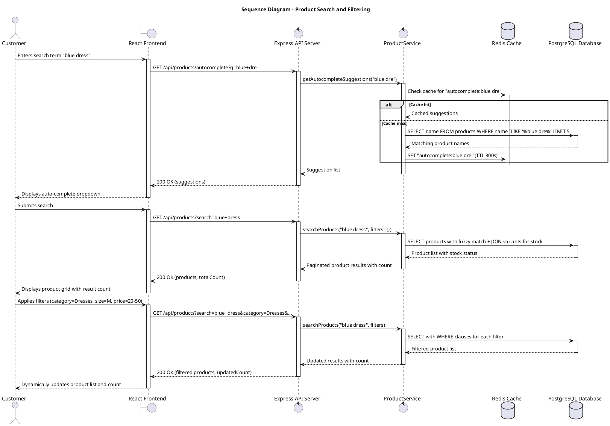

## 4.3 Add to cart and checkout

**Figure 7: Sequence Diagram – Add to Cart and Checkout**

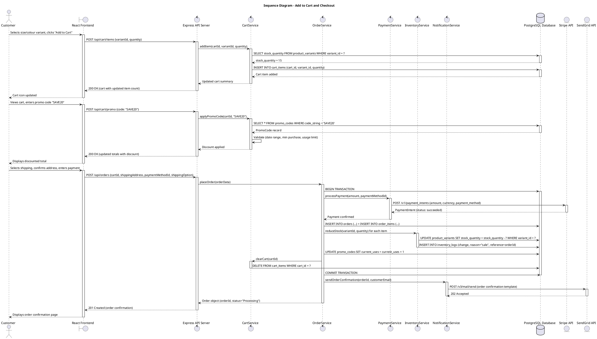

## 4.4 Order tracking

**Figure 8: Sequence Diagram – Order Tracking**

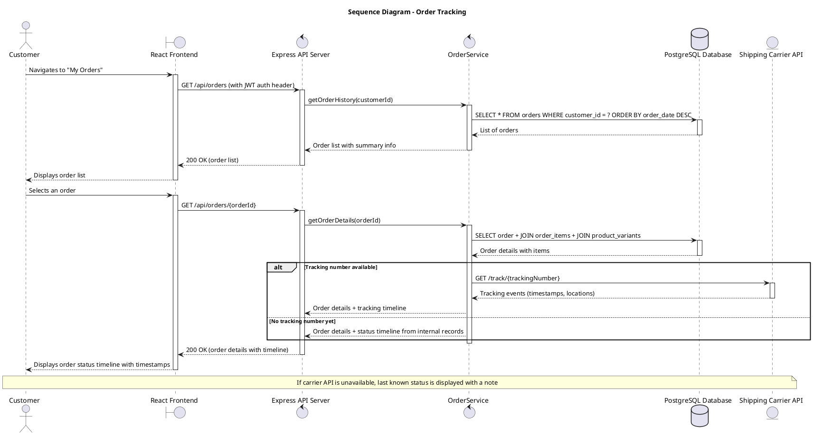

## 4.5 Process return and refund

**Figure 9: Sequence Diagram – Process Return and Refund**

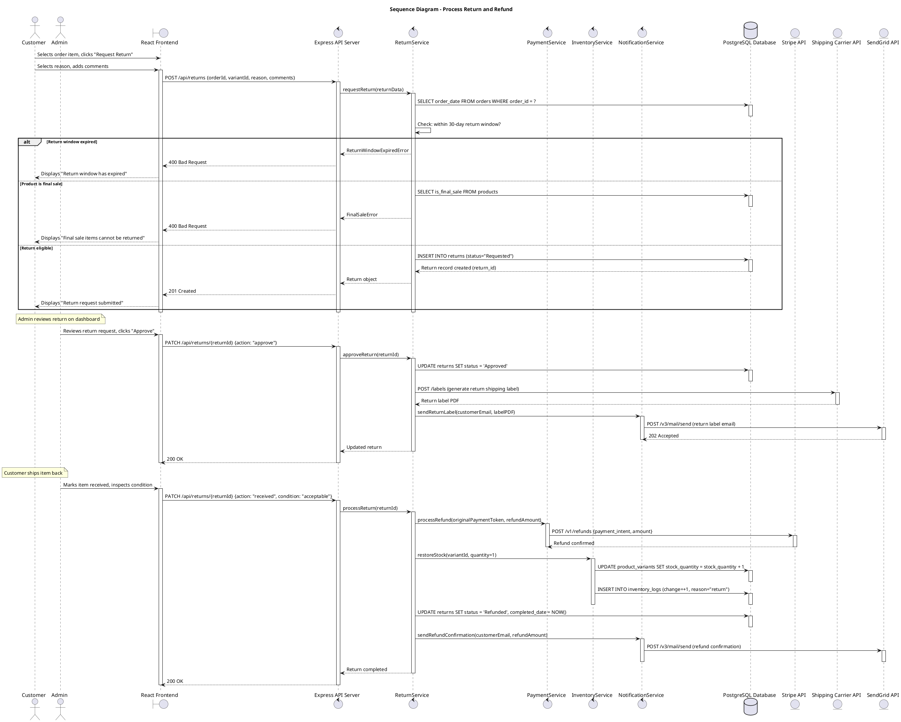

## 4.6 Manage inventory

**Figure 10: Sequence Diagram – Manage Inventory**

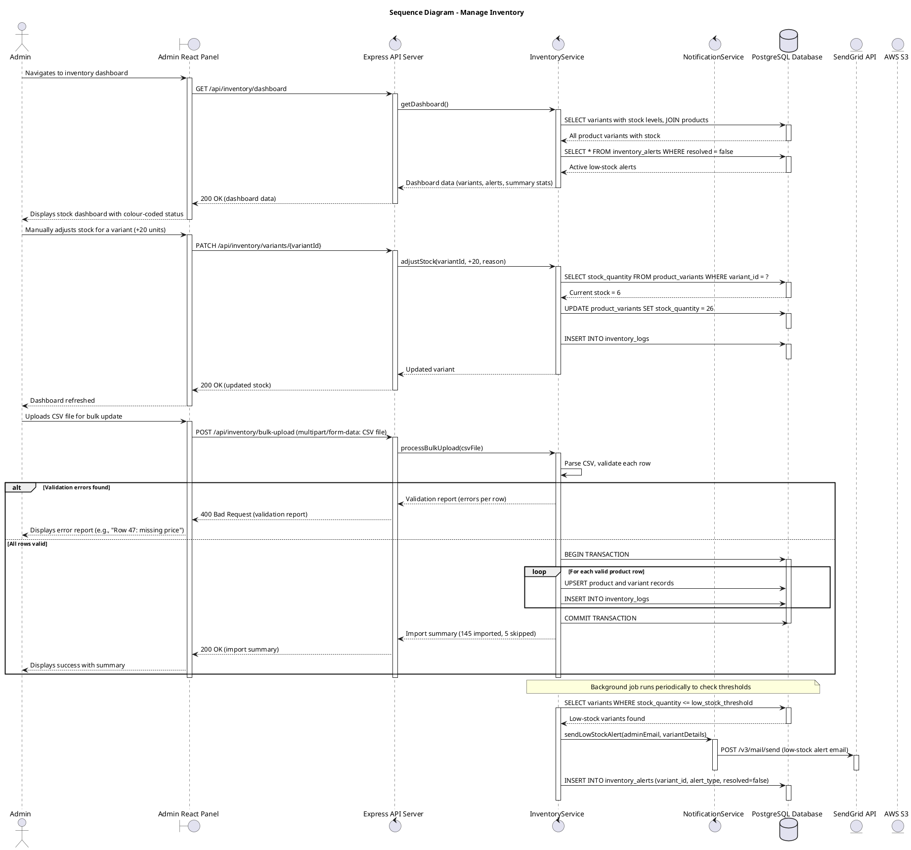

---

# **CHAPTER 5: UI/UX DESIGN**

This chapter presents the user interface and user experience design for the Dickwella Fashion Corner system, including wireframe descriptions, user flow diagrams, and accessibility considerations.

## 5.1 Wireframes and screen mock-ups

The following wireframe descriptions outline the key user interface screens. Each wireframe adheres to the responsive design requirements (320px to 2560px) and follows the UI requirements specified in SRS Chapter 12.

**Figure 11: Wireframe – Customer Homepage**

The homepage is structured with the following elements:

- **Persistent Header:** Contains the Dickwella Fashion Corner logo (left), a central search bar with auto-complete, a cart icon with item count badge (right), a user account dropdown menu (right), and a wishlist icon.
- **Navigation Bar:** Horizontal category links (All, Shirts, Pants, Dresses, Accessories, Sale) with dropdown sub-categories on hover.
- **Hero Banner Carousel:** Full-width rotating banners showcasing current promotions, new arrivals, and seasonal collections.
- **Featured Products Grid:** A 4-column grid (desktop) displaying trending products with thumbnail images, product name, price, and star rating. On mobile, this collapses to a 2-column grid.
- **Category Showcase:** Visual cards for each major product category with representative imagery.
- **Footer:** Links to About Us, Contact, FAQs, Return Policy, Privacy Policy, Terms of Service, and social media icons.

**Figure 12: Wireframe – Product Listing Page**

- **Left Sidebar (Desktop) / Collapsible Filters (Mobile):** Filter panel containing checkboxes for category, size, and brand; colour swatches for colour selection; a dual-handle slider for price range; and a "Clear All Filters" button.
- **Product Grid:** Configurable grid/list view toggle. Each product card displays a product image, product name, price, star rating, and stock status badge ("In Stock," "Only X left," "Out of Stock"). A hover effect reveals a quick "Add to Cart" button.
- **Sorting Dropdown:** Options for sorting by relevance, price (low to high / high to low), newest arrivals, and customer rating.
- **Pagination:** Numbered page controls with "Previous" and "Next" buttons at the bottom.
- **Result Count:** Displays "Showing X of Y products" with dynamic updates as filters are applied.

**Figure 13: Wireframe – Product Detail Page**

- **Image Gallery (Left):** Large main image with zoom-on-hover functionality and a thumbnail strip below for additional images.
- **Product Information (Right):** Product name, price, star rating with review count link, material and care instructions, structured specifications table, size selector (buttons), colour selector (swatches), quantity input with +/- buttons, "Add to Cart" primary button, "Add to Wishlist" secondary button, and stock availability indicator.
- **Tabs Below Product:** Description (rich text), Reviews and Ratings (star breakdown bar chart, individual reviews with verified purchase badge), and Shipping Information.
- **Related Products:** A horizontal scrollable row of similar product recommendations.

**Figure 14: Wireframe – Shopping Cart and Checkout**

- **Cart Review Stage:** Table-style display of cart items with product image thumbnail, name with variant details (size/colour), unit price, quantity selector, item subtotal, and a remove (×) button. Below: promo code input with "Apply" button, subtotal, tax, shipping estimate, discount (if applied), and total.
- **Checkout Flow (Stepped):** A horizontal progress indicator showing three steps: (1) Shipping, (2) Payment, (3) Confirmation. Each step is a distinct panel with form fields that auto-fill for registered customers with saved data.
- **Order Confirmation:** Displays order number, order summary, estimated delivery date, and a "Continue Shopping" button.

**Figure 15: Wireframe – Admin Dashboard**

- **Left Sidebar Navigation:** Collapsible navigation with icons and labels for Dashboard, Products, Inventory, Orders, Customers, Marketing, Analytics, Support, and Settings.
- **Main Content Area:** Summary cards at the top showing today's revenue, order count, new customers, and low-stock alerts (with colour-coded badges). Below: a line chart for sales trends (last 7/30/90 days), a recent orders table with quick-action buttons (View, Process, Ship), and a notification panel for pending alerts.

## 5.2 User flow and navigation diagrams

**Figure 16: User Flow / Navigation Diagram**

```plantuml
@startuml
title User Flow / Navigation Diagram

state "Homepage" as HP
state "Product Listing Page" as PLP
state "Search Results" as SEARCH
state "Login / Register" as LOGIN
state "Shopping Cart" as CART
state "Product Detail Page" as PDP
state "Wishlist" as WISHLIST
state "Checkout: Shipping" as CHECKOUT_SHIP
state "Checkout: Payment" as CHECKOUT_PAY
state "Order Confirmation" as ORDER_CONF
state "My Account" as ACCOUNT
state "Order History" as ORDER_HIST
state "Saved Addresses" as ADDR
state "Preferences" as PREFS
state "Loyalty Dashboard" as LOYALTY_PAGE
state "Order Detail / Tracking" as ORDER_DET
state "Request Return" as RETURN_REQ
state "Live Chat / Chatbot" as CHAT

state "Admin Panel" {
  state "Admin Dashboard" as ADMIN_DASH
  state "Inventory Management" as INV
  state "Order Management" as ORD_MGT
  state "Customer Database" as CUST_DB
  state "Marketing Campaigns" as MKTG
  state "Analytics & Reports" as ANALYTICS
  state "Support / Chat Management" as SUPPORT
  state "Returns Processing" as RET_PROC
}

HP --> PLP
HP --> SEARCH
HP --> LOGIN
HP --> CART

PLP --> PDP
SEARCH --> PDP

PDP --> CART
PDP --> WISHLIST

CART --> CHECKOUT_SHIP
CHECKOUT_SHIP --> CHECKOUT_PAY
CHECKOUT_PAY --> ORDER_CONF

LOGIN --> ACCOUNT
ACCOUNT --> ORDER_HIST
ACCOUNT --> ADDR
ACCOUNT --> PREFS
ACCOUNT --> LOYALTY_PAGE

ORDER_HIST --> ORDER_DET
ORDER_DET --> RETURN_REQ

HP --> CHAT

ADMIN_DASH --> INV
ADMIN_DASH --> ORD_MGT
ADMIN_DASH --> CUST_DB
ADMIN_DASH --> MKTG
ADMIN_DASH --> ANALYTICS
ADMIN_DASH --> SUPPORT
ORD_MGT --> RET_PROC
@enduml
```

## 5.3 Accessibility considerations

The system is designed to comply with **WCAG 2.1 Level AA** accessibility guidelines (NFR-008). The following measures are implemented:

**Table 4: UI Accessibility Compliance Checklist**

| WCAG Criterion                      | Implementation                                                                                                 |
| ----------------------------------- | -------------------------------------------------------------------------------------------------------------- |
| 1.1.1 Non-text Content              | All product images include descriptive `alt` text. Decorative images use empty `alt=""` attributes.             |
| 1.3.1 Info and Relationships         | Semantic HTML5 elements (`<nav>`, `<main>`, `<article>`, `<section>`, `<header>`, `<footer>`) are used throughout. Forms use `<label>` elements associated with inputs. |
| 1.4.3 Contrast (Minimum)            | All text meets a minimum contrast ratio of 4.5:1 against its background. Large text meets 3:1.                  |
| 1.4.4 Resize Text                   | Text can be resized up to 200% without loss of content or functionality.                                        |
| 2.1.1 Keyboard                      | All interactive elements (links, buttons, form fields, modals) are accessible and operable via keyboard.        |
| 2.4.1 Bypass Blocks                 | A "Skip to main content" link is provided at the top of each page.                                              |
| 2.4.7 Focus Visible                 | A visible focus indicator (outline) is displayed on the currently focused interactive element.                    |
| 3.1.1 Language of Page              | The `lang` attribute is set on the `<html>` element (e.g., `lang="en"`).                                       |
| 3.3.1 Error Identification          | Form validation errors are identified in text, associated with the corresponding input field, and announced to screen readers using ARIA `aria-describedby` and `role="alert"`. |
| 3.3.2 Labels or Instructions        | All form inputs have visible, descriptive labels. Required fields are clearly marked.                            |
| 4.1.2 Name, Role, Value             | Custom UI components (dropdowns, modals, tabs) use appropriate ARIA roles, states, and properties.             |

---

# **CHAPTER 6: SECURITY DESIGN**

This chapter describes the security architecture of the Dickwella Fashion Corner system, covering authentication, authorisation, data protection, input validation, and encryption standards.

## 6.1 Authentication mechanism

The system employs a **JWT (JSON Web Token)-based authentication mechanism** for stateless, scalable user session management.

**Authentication Flow:**

1. **Registration:** Customer credentials are collected via the registration form. The password is hashed using the bcrypt algorithm with a minimum work factor of 10 (NFR-012) before being stored in the database. Full card numbers and CVV codes are never stored on the server (NFR-011).
2. **Login:** The customer submits email and password. The system retrieves the stored hash for the provided email and verifies the password against the hash using bcrypt's compare function. Upon successful authentication, a JWT access token (expiry: 1 hour) and a refresh token (expiry: 7 days, stored in an HTTP-only secure cookie) are issued.
3. **Token Structure:** The JWT payload contains the customer ID, email, role (customer/admin), and token expiration timestamp. The token is signed using the HS256 algorithm with a server-side secret key.
4. **Token Refresh:** When the access token expires, the client automatically sends the refresh token to obtain a new access token without requiring the user to re-enter credentials.
5. **Password Recovery:** A time-limited (1 hour) password reset token is generated and sent to the registered email address. The token is a cryptographically secure random string stored as a hash in the database.

**Figure 17: Security Architecture Diagram**

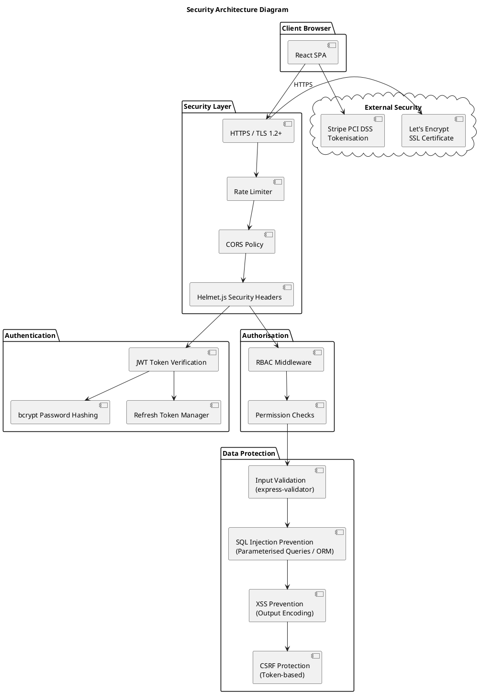

## 6.2 Authorisation levels

Role-Based Access Control (RBAC) is implemented to restrict system access based on the authenticated user's role. Three primary roles are defined:

**Table 5: Authentication and Authorisation Levels**

| Role              | Description                                                              | Access Scope                                                                                                     |
| ----------------- | ------------------------------------------------------------------------ | ---------------------------------------------------------------------------------------------------------------- |
| Guest Customer     | An unauthenticated visitor browsing the storefront.                      | Product browsing, search, filtering, adding to cart, guest checkout, chatbot interaction.     |
| Registered Customer| An authenticated customer with a verified account.                       | All guest capabilities plus: wishlist management, order history, order tracking, return requests, reviews and ratings, saved addresses and payment methods, loyalty programme, live chat, notification preferences. |
| Admin / Inventory Manager | An authenticated administrator with elevated privileges.           | Full admin panel access: product and inventory management, order processing, returns and refund processing, customer database, CRM tools, marketing campaigns, analytics and reports, loyalty programme management, chat agent dashboard, AI chatbot configuration, system settings. |

**Middleware Implementation:** Every API route is protected by an authorisation middleware function that: (1) verifies the JWT token, (2) extracts the user role from the token payload, and (3) checks whether the role has permission to access the requested resource. Unauthorised access attempts receive a 403 Forbidden response.

## 6.3 Data protection approach

The following data protection measures are implemented to comply with applicable data protection regulations (e.g., GDPR, local data protection acts) and PCI DSS standards:

- **Data Minimisation:** Only data necessary for the system's functionality is collected. Guest checkout requires only email, shipping address, and payment information for the current order.
- **Payment Data Handling:** Full credit card numbers and CVV codes are never transmitted to or stored on the application server. Payment processing is delegated to PCI DSS Level 1 compliant gateways (Stripe, PayPal) which return a payment token for reference (NFR-011).
- **Data at Rest:** Sensitive customer data (personal information, addresses, order details) stored in the PostgreSQL database is protected using AES-256 encryption at the storage level via Amazon RDS encryption.
- **Data Retention Policies:** Order data is retained for 7 years, chat logs for 2 years, and inventory logs for 3 years. Customer data is retained until a deletion request is made, subject to legal obligations.
- **Data Deletion:** Customers may request account deletion. Upon request, personal data is anonymised (soft delete with `deleted_at` timestamp), and the associated email and personal identifiers are replaced with anonymised values, while order records are retained for legal compliance.
- **Backup Security:** Database backups (daily full, 6-hourly incremental) are encrypted using AES-256 and stored in a geographically separate AWS S3 bucket with server-side encryption enabled.

## 6.4 Input validation and sanitisation strategy

A defence-in-depth approach to input validation is adopted, with validation performed at both the client-side and server-side layers:

**Client-Side Validation (React):**
- Real-time form field validation provides immediate user feedback (e.g., email format, password strength meter, required fields).
- Client-side validation is for user experience only and is never relied upon as a security measure.

**Server-Side Validation (Express.js):**
- The `express-validator` library is used to validate and sanitise all incoming request data before processing.
- **Type Checking:** All inputs are validated for expected data types (string, integer, decimal, boolean, date).
- **Length Constraints:** String inputs are constrained to appropriate maximum lengths to prevent buffer overflow attacks.
- **Pattern Matching:** Email addresses, phone numbers, and postal codes are validated against regular expression patterns.
- **Range Validation:** Numerical inputs (quantity, price, rating) are validated to be within acceptable ranges.
- **SQL Injection Prevention:** All database queries are executed through the Sequelize ORM, which uses parameterised queries by default. No raw SQL string concatenation is used.
- **XSS Prevention:** All user-generated content (product reviews, chat messages, customer comments) is sanitised using a whitelist-based HTML sanitiser before storage. Output encoding is applied when rendering user-generated content in HTML.
- **CSRF Protection:** Anti-CSRF tokens are generated for all state-changing requests. The `csurf` middleware is employed for form-based CSRF protection, and the `SameSite` cookie attribute is set to `Strict` for session cookies.
- **Rate Limiting:** API endpoints are rate-limited using the `express-rate-limit` middleware (e.g., 100 requests per 15-minute window per IP for general endpoints; 5 login attempts per 15-minute window per IP).

The system is designed to pass OWASP Top 10 vulnerability scans with zero critical or high-severity findings (NFR-013).

## 6.5 Encryption standards

**Table 6: Encryption Standards Summary**

| Data Category               | Encryption Standard           | Implementation                                                                          |
| --------------------------- | ----------------------------- | --------------------------------------------------------------------------------------- |
| Data in Transit             | TLS 1.2+ (NFR-010)           | All client-server communication uses HTTPS. HTTP Strict Transport Security (HSTS) headers are set. |
| Passwords                   | bcrypt (work factor ≥ 10)    | Passwords are salted and hashed using bcrypt before storage (NFR-012).                   |
| Data at Rest (Database)     | AES-256                       | Amazon RDS encryption is enabled for the PostgreSQL database at the storage layer.       |
| Data at Rest (Backups)      | AES-256                       | Backup files on S3 are encrypted using AWS Server-Side Encryption (SSE-S3).              |
| Data at Rest (File Storage) | AES-256                       | Product images and uploaded files on S3 use server-side encryption.                      |
| Payment Data                | PCI DSS Tokenisation          | Card data is tokenised by the payment gateway (Stripe/PayPal); only tokens are stored.   |
| JWT Tokens                  | HS256 (HMAC-SHA256)           | JWT tokens are signed using a 256-bit secret key to prevent tampering.                   |
| Password Reset Tokens       | SHA-256                       | Reset tokens are hashed before database storage; plaintext tokens are sent to user email. |
| WebSocket Connections       | WSS (WebSocket Secure)        | All WebSocket connections for live chat and real-time updates use the WSS protocol over TLS. |

---

# **CHAPTER 7: DEPLOYMENT DESIGN**

This chapter describes the deployment strategy, hosting plan, hardware requirements, environment specifications, and CI/CD pipeline for the Dickwella Fashion Corner system.

## 7.1 Hosting plan

The system is hosted on **Amazon Web Services (AWS)**, selected for its reliability, global availability, comprehensive managed services, and a 12-month free tier suitable for the initial academic development phase. The hosting architecture is designed to support containerised deployment using Docker (NFR-019).

**Core AWS Services:**

- **Amazon EC2 / AWS ECS (Fargate):** The Node.js application containers are deployed on AWS ECS using Fargate for serverless container management, eliminating the need to manage underlying EC2 instances. During the development phase, a single EC2 t3.medium instance may be used for cost efficiency.
- **Amazon RDS (PostgreSQL):** A managed PostgreSQL 16 instance serves as the primary database, with automated backups, patching, and optional multi-AZ deployment for high availability.
- **Amazon ElastiCache (Redis):** A managed Redis 7 cluster provides session storage, query result caching, and rate limiting.
- **Amazon S3:** Object storage for product images, bulk upload files, generated invoices, and database backups.
- **Amazon CloudFront:** CDN for delivering static frontend assets (JavaScript bundles, CSS, images) with low latency globally.
- **AWS Application Load Balancer (ALB):** Distributes incoming HTTPS traffic across multiple application containers and handles SSL termination.
- **Amazon Route 53:** DNS management for the application domain.
- **AWS Certificate Manager:** Provides free SSL/TLS certificates for HTTPS.

**Figure 18: Deployment Architecture Diagram**

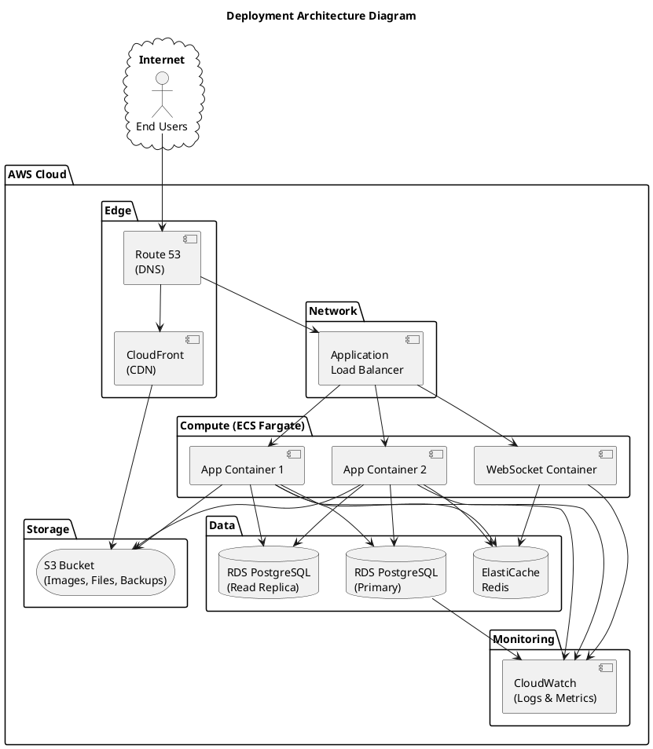

## 7.2 Hardware requirements

**Table 7: Hardware Requirements**

| Component             | Development / Staging              | Production                                          |
| --------------------- | ---------------------------------- | --------------------------------------------------- |
| Application Server    | 1× EC2 t3.medium (2 vCPU, 4 GB RAM) | 2× ECS Fargate tasks (2 vCPU, 4 GB RAM each), auto-scaling to 4 |
| WebSocket Server      | Shared with application server     | 1× ECS Fargate task (1 vCPU, 2 GB RAM), auto-scaling to 2      |
| Database Server       | 1× RDS db.t3.medium (2 vCPU, 4 GB RAM) | 1× RDS db.r6g.large (2 vCPU, 16 GB RAM) + 1 read replica       |
| Cache Server          | 1× ElastiCache cache.t3.micro (0.5 GB) | 1× ElastiCache cache.r6g.large (13 GB)                          |
| Object Storage        | S3 Standard (estimated 10 GB)       | S3 Standard (estimated 100 GB for product images and backups)    |
| CDN                   | Not required for development        | CloudFront distribution (global edge locations)                  |
| Estimated Monthly Cost| $50–$80                             | $150–$300 (varies with traffic and storage)                      |

## 7.3 Environment specification

Three environments are maintained to support the development lifecycle:

**Table 8: Environment Specification**

| Attribute         | Development                        | Staging                              | Production                           |
| ----------------- | ---------------------------------- | ------------------------------------ | ------------------------------------ |
| Purpose           | Active development and debugging   | Integration testing and UAT          | Live system serving end users         |
| URL               | localhost:3000 / localhost:5000     | staging.dickwellafashion.lk          | www.dickwellafashion.lk              |
| Database          | Local PostgreSQL or Docker container | RDS instance (separate from production) | RDS instance with read replica       |
| Data              | Seed data / mock data              | Anonymised copy of production data   | Live customer and order data          |
| SSL               | Self-signed certificate            | AWS Certificate Manager              | AWS Certificate Manager              |
| Payment Gateway   | Stripe/PayPal test/sandbox mode    | Stripe/PayPal test/sandbox mode      | Stripe/PayPal live mode              |
| Email Delivery    | Console output / Mailtrap sandbox  | SendGrid sandbox                     | SendGrid production                  |
| Logging Level     | DEBUG                              | INFO                                 | WARN / ERROR                         |
| Access            | Development team only              | Development team + client (UAT)      | Public                               |
| Deployment Method | Manual / Docker Compose            | Automated via CI/CD pipeline         | Automated via CI/CD pipeline         |

## 7.4 CI/CD pipeline overview

A Continuous Integration / Continuous Deployment pipeline is configured using **GitHub Actions** to automate testing and deployment:

**Figure 19: CI/CD Pipeline Overview Diagram**

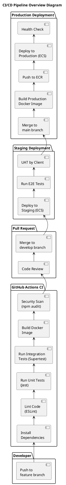

**Pipeline Stages:**

1. **Build:** Dependencies are installed, and the application is compiled.
2. **Lint:** Code quality is enforced using ESLint with a project-specific configuration.
3. **Test:** Unit tests (Jest) and integration tests (Supertest) are executed. A minimum of 50% code coverage is required for the pipeline to pass.
4. **Security Scan:** `npm audit` is run to detect known vulnerabilities in dependencies.
5. **Docker Build:** A production Docker image is built and tagged with the commit hash.
6. **Deploy to Staging:** The Docker image is deployed to the staging ECS environment for integration testing and UAT.
7. **Deploy to Production:** Upon approval and merge to the main branch, the image is pushed to Amazon ECR and deployed to the production ECS cluster. A health check confirms successful deployment before traffic is routed to the new version.

---

# **CHAPTER 8: REFERENCES**

[1] [Team Member Names], "Software Requirement Specification (SRS) – Dickwella Fashion Corner Online Clothing Shop," University of Kelaniya, 2026.

[2] IEEE, "IEEE Recommended Practice for Software Requirements Specifications," IEEE Std 830-1998, 1998.

[3] K. E. Wiegers and J. Beatty, _Software Requirements_, 3rd ed. Redmond, WA, USA: Microsoft Press, 2013.

[4] ISO/IEC, "ISO/IEC 25010:2011, Systems and Software Engineering – Systems and Software Quality Requirements and Evaluation (SQuaRE) – System and Software Quality Models," 2011.

[5] E. Gamma, R. Helm, R. Johnson, and J. Vlissides, _Design Patterns: Elements of Reusable Object-Oriented Software_. Boston, MA, USA: Addison-Wesley, 1994.

[6] C. Richardson, _Microservices Patterns: With Examples in Java_. Shelter Island, NY, USA: Manning Publications, 2018.

[7] Stripe, Inc., "Stripe API Reference," [Online]. Available: [https://stripe.com/docs/api](https://stripe.com/docs/api).

[8] PayPal, Inc., "PayPal Developer Documentation," [Online]. Available: [https://developer.paypal.com/docs/](https://developer.paypal.com/docs/).

[9] Twilio SendGrid, "SendGrid Email API Documentation," [Online]. Available: [https://docs.sendgrid.com/](https://docs.sendgrid.com/).

[10] W3C, "Web Content Accessibility Guidelines (WCAG) 2.1," [Online]. Available: [https://www.w3.org/TR/WCAG21/](https://www.w3.org/TR/WCAG21/).

[11] PCI Security Standards Council, "PCI Data Security Standard (PCI DSS)," [Online]. Available: [https://www.pcisecuritystandards.org/](https://www.pcisecuritystandards.org/).

[12] IETF, "RFC 6455 – The WebSocket Protocol," [Online]. Available: [https://tools.ietf.org/html/rfc6455](https://tools.ietf.org/html/rfc6455).

[13] IETF, "RFC 8030 – Generic Event Delivery Using HTTP Push," [Online]. Available: [https://tools.ietf.org/html/rfc8030](https://tools.ietf.org/html/rfc8030).

[14] Meta Platforms, Inc., "React – A JavaScript library for building user interfaces," [Online]. Available: [https://react.dev/](https://react.dev/).

[15] OpenJS Foundation, "Node.js Documentation," [Online]. Available: [https://nodejs.org/docs/](https://nodejs.org/docs/).

[16] OpenJS Foundation, "Express.js – Fast, unopinionated, minimalist web framework for Node.js," [Online]. Available: [https://expressjs.com/](https://expressjs.com/).

[17] The PostgreSQL Global Development Group, "PostgreSQL Documentation," [Online]. Available: [https://www.postgresql.org/docs/](https://www.postgresql.org/docs/).

[18] Sequelize Authors, "Sequelize ORM Documentation," [Online]. Available: [https://sequelize.org/](https://sequelize.org/).

[19] Redis Ltd., "Redis Documentation," [Online]. Available: [https://redis.io/docs/](https://redis.io/docs/).

[20] Docker, Inc., "Docker Documentation," [Online]. Available: [https://docs.docker.com/](https://docs.docker.com/).

[21] Amazon Web Services, Inc., "AWS Documentation," [Online]. Available: [https://docs.aws.amazon.com/](https://docs.aws.amazon.com/).

[22] OWASP Foundation, "OWASP Top Ten," [Online]. Available: [https://owasp.org/www-project-top-ten/](https://owasp.org/www-project-top-ten/).

[23] GitHub, Inc., "GitHub Actions Documentation," [Online]. Available: [https://docs.github.com/en/actions](https://docs.github.com/en/actions).

---

_End of Document_
