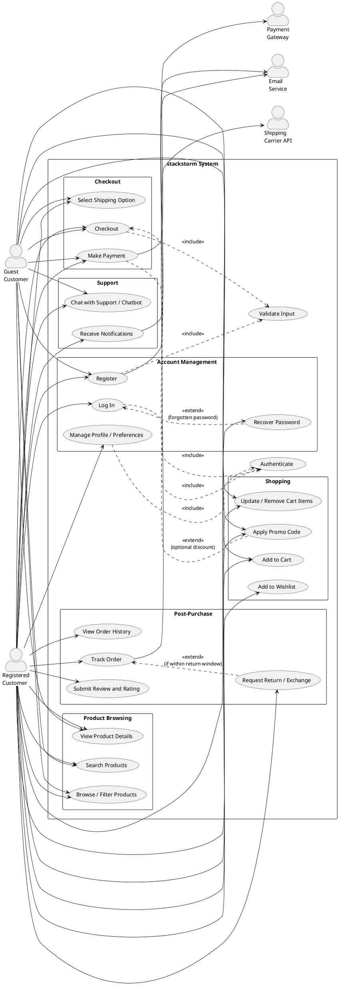
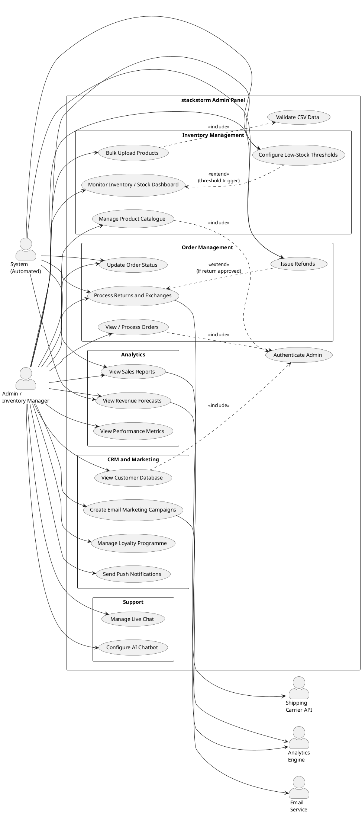
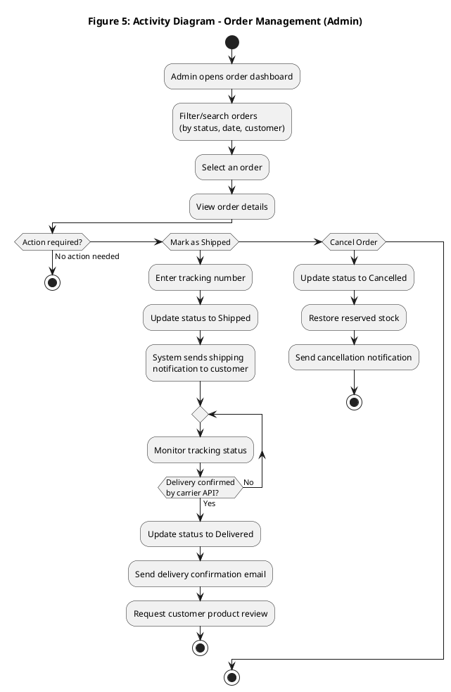
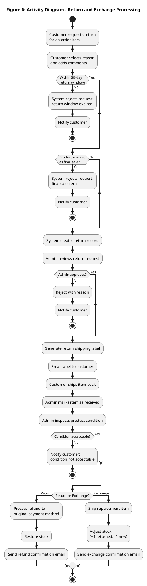

**SOFTWARE REQUIREMENT SPECIFICATION (SRS)**

---

**SENG 31242 – Software Engineering**

**University of Kelaniya**

---

| Field          | Detail                                          |
| -------------- | ----------------------------------------------- |
| Document Title | Software Requirement Specification              |
| Project Name   | stackstorm                                      |
| Created Date   | 2025/07/23                                      |
| Last Updated   | 2026/04/27                                      |
| Version No     | 02                                              |

---

**Authors**

By 
* Amarawickrama R.H. (SE/2021/004)
* S. Thanoogithan (SE/2021/005)
* B.K. Pabasara (SE/2021/009)
* Lakshani A.T. (SE/2021/041)

---

**Version history**

|Version|Date|Author(s)|Summary of Changes|
|---|---|---|---|
|01|2026/03/16|[Team Member Names]|Initial SRS draft|
|02|2026/04/27|Amarawickrama R.H., S. Thanoogithan, B.K. Pabasara, Lakshani A.T.|Updated structure and project name to stackstorm|

---

**List of figures**

|Figure No.|Caption|Page|
|---|---|---|
|Figure 1|Use Case Diagram – Customer Module||
|Figure 2|Use Case Diagram – Admin Module||
|Figure 3|Activity Diagram – Customer Registration & Login||
|Figure 4|Activity Diagram – Product Browsing & Purchase||
|Figure 5|Activity Diagram – Order Management (Admin)||
|Figure 6|Activity Diagram – Return & Exchange Processing||

**List of tables**

|Table No.|Caption|Page|
|---|---|---|
|Table 1|Definitions, Acronyms and Abbreviations||
|Table 2|Stakeholder Register||
|Table 3|Functional Requirements||
|Table 4|Non-Functional Requirements||
|Table 5|Risk Register||

---

**TABLE OF CONTENTS**

1. Introduction
2. Purpose
3. Scope
4. Definitions, Acronyms and Abbreviations
5. Document Overview
6. Project Scope
7. Stakeholders
8. Functional Requirements
9. Non-Functional Requirements
10. Business Rules
11. Constraints
12. Assumptions
13. Use Case Diagrams
14. Use Case Descriptions
15. Activity Diagrams
16. External Interface Requirements
    - 16.1 User Interface Requirements
    - 16.2 Hardware Interface Requirements
    - 16.3 Software Interface Requirements
    - 16.4 Communications Interface Requirements
17. Data Requirements
18. Alternative Solutions Considered
19. Feasibility Study
    - 19.1 Technical Feasibility
    - 19.2 Economic Feasibility
    - 19.3 Operational Feasibility
    - 19.4 Schedule Feasibility
20. Risk Analysis
21. References

---

# **CHAPTER 1: INTRODUCTION**

This section establishes the foundation of the Software Requirement Specification (SRS) document for the stackstorm system (Dickwella Fashion Corner online clothing shop).

# **CHAPTER 2: PURPOSE**

The purpose of this Software Requirement Specification (SRS) document is to provide a comprehensive and detailed description of the functional and non-functional requirements for the stackstorm system (Dickwella Fashion Corner online clothing shop). This document is intended for the project development team, the client, the project supervisor, quality assurance personnel, and any other stakeholders involved in the design, development, testing, and deployment of the stackstorm system. It serves as a contractual agreement between the client and the development team regarding the scope, features, and constraints of the system.

# **CHAPTER 3: SCOPE**

**System Name:** stackstorm (Dickwella Fashion Corner online clothing shop)

**Description:** stackstorm is a web-based e-commerce platform designed to facilitate the online sale of clothing products. The system shall provide customers with a seamless shopping experience, including product browsing with advanced search and filtering, a shopping cart, wishlist management, secure multi-method checkout, order tracking, and customer account management. For administrators, the system shall provide comprehensive tools for inventory management, order processing, customer relationship management (CRM), analytics and reporting, and customer support through live chat and AI chatbot capabilities.

**Explicit Exclusions:**

- Physical point-of-sale (POS) terminal integration is excluded from the initial release.
- Native mobile application development is excluded; the system shall be responsive and mobile-friendly via the web browser only.
- Multi-currency support is excluded from the initial release.

# **CHAPTER 4: DEFINITIONS, ACRONYMS AND ABBREVIATIONS**

**Table 1: Definitions, Acronyms and Abbreviations**

|Term / Acronym|Definition|
|---|---|
|SRS|Software Requirement Specification|
|API|Application Programming Interface – a set of protocols enabling communication between software components|
|CRM|Customer Relationship Management – tools and processes for managing customer interactions|
|SSL|Secure Sockets Layer – a security protocol for encrypted data transmission|
|HTTPS|Hypertext Transfer Protocol Secure – web communication protocol secured with SSL/TLS|
|PCI DSS|Payment Card Industry Data Security Standard – security standards for card payment processing|
|CSV|Comma-Separated Values – a file format for tabular data|
|SKU|Stock Keeping Unit – a unique identifier for each product variant|
|AOV|Average Order Value – total revenue divided by number of orders|
|CAC|Customer Acquisition Cost – marketing spend divided by new customers acquired|
|ROAS|Return on Ad Spend – revenue generated per unit of advertising expenditure|
|RFM|Recency, Frequency, Monetary – a customer segmentation analysis technique|
|NLP|Natural Language Processing – AI techniques for understanding human language|
|WebSocket|A communication protocol providing full-duplex channels over a single TCP connection|
|SMTP|Simple Mail Transfer Protocol – standard protocol for sending email messages|
|MVP|Minimum Viable Product – a product with just enough features for early adopters|
|UI|User Interface|
|NFR|Non-Functional Requirement|
|FR|Functional Requirement|

# **CHAPTER 5: DOCUMENT OVERVIEW**

This document is organised as follows. Chapter 6 describes the overall project scope. Chapter 7 identifies the stakeholders. Chapters 8 and 9 present the functional and non-functional requirements, respectively. Chapter 10 lists the business rules, Chapter 11 the constraints, and Chapter 12 the assumptions. Chapters 13 through 15 contain the use case diagrams, use case descriptions, and activity diagrams. Chapter 16 covers external interface requirements. Chapter 17 addresses data requirements. Chapter 18 discusses alternative solutions considered. Chapter 19 presents the feasibility study, and Chapter 20 contains the risk analysis. Finally, Chapter 21 lists references.

---

# **CHAPTER 6: PROJECT SCOPE**

stackstorm aims to deliver a fully functional system that empowers both customers and business administrators. The system is divided into the following major modules:

**Customer-Facing Module:**

- Smart product catalogue with advanced search, dynamic filtering, real-time stock display, and detailed product descriptions with image galleries.
- Seamless shopping experience with wishlist, shopping cart and customer reviews and ratings.
- Comprehensive account management including order history, real-time order tracking, saved preferences, and multi-channel notifications.
- Secure checkout supporting multiple payment methods (credit/debit cards, digital wallets, mobile payments), guest checkout, promotional/discount codes.

**Admin Management Module:**

- Inventory system with real-time stock tracking across product variants, automated low-stock alerts, bulk product upload via CSV/Excel, and inventory analytics.
- Order management with a centralised dashboard, automated order status updates, and a returns and exchange processing workflow.
- CRM tools including a searchable customer database, purchase history with RFM analysis, email marketing campaigns with segmentation and automation, and a tiered loyalty programme with a points system.
- Analytics and reports covering sales tracking, performance metrics, customer behaviour insights, and revenue forecasting.

**Support and Engagement Module:**

- Live chat with real-time WebSocket-based messaging and agent dashboard.
- AI chatbot for 24/7 automated support with NLP-based intent recognition and escalation to human agents.
- Email campaigns with segmentation, personalisation, and performance tracking.
- Push notifications and optional SMS notifications with frequency controls and opt-in compliance.

---

# **CHAPTER 7: STAKEHOLDERS**

**Table 2: Stakeholder Register**

| Stakeholder                | Role / Interest                                                                                                          |
| -------------------------- | ------------------------------------------------------------------------------------------------------------------------ |
| Shop Owner (Client)        | Business owner who commissions the system; primary decision-maker on features, scope, and budget.                        |
| Customers                  | End users who browse, purchase, and interact with the system; their satisfaction drives business success.                |
| Development Team           | Software engineers responsible for design, implementation, testing, and deployment of stackstorm.                        |
| Project Supervisor         | University supervisor overseeing the project for academic compliance and quality assurance.                              |
| System Administrator       | Personnel responsible for system deployment, maintenance, server management, and security updates.                       |
| Payment Gateway Provider   | Third-party services (e.g., Stripe, PayPal) providing secure payment processing APIs.                                    |
| Shipping Carriers          | Logistics companies (e.g., FedEx, UPS) whose APIs are integrated for shipping rate calculation and tracking.             |
| Email/SMS Service Provider | Third-party services (e.g., SendGrid, Twilio) providing email delivery and SMS notification capabilities.                |

---

# **CHAPTER 8: FUNCTIONAL REQUIREMENTS**

**Table 3: Functional Requirements**

|ID|Description|Priority|Source|Status|
|---|---|---|---|---|
|FR-001|The system shall allow customers to search for products by name, description, and tags with auto-complete and fuzzy matching.|High|Shop Owner|Proposed|
|FR-002|The system shall provide dynamic filtering by category, size, colour, price range, and brand with real-time product count updates.|High|Shop Owner|Proposed|
|FR-003|The system shall display real-time stock availability per product variant (size/colour combination) with status labels (In Stock, Only X left, Out of Stock).|High|Shop Owner|Proposed|
|FR-004|The system shall display detailed product descriptions with image galleries, zoom functionality, material, care instructions, and structured specifications.|High|Shop Owner|Proposed|
|FR-005|The system shall allow registered customers to add products to a wishlist and notify them when wishlisted items go on sale.|Medium|Customers|Proposed|
|FR-006|The system shall provide a shopping cart with session management, item quantity updates, price calculations (subtotal, tax, shipping, total), and a save-for-later option.|High|Shop Owner|Proposed|
|FR-007|The system shall allow verified purchasers to submit star ratings (1–5), written reviews, and optional photo uploads; reviews shall display verification badges and helpful votes.|Medium|Customers|Proposed|
|FR-008|The system shall display a customer's complete order history with order details, item images, payment method, shipping address, and downloadable PDF invoices.|High|Shop Owner|Proposed|
|FR-009|The system shall provide real-time order tracking with a status timeline (Order Placed → Processing → Shipped → Out for Delivery → Delivered) and integration with shipping carrier APIs.|High|Shop Owner|Proposed|
|FR-010|The system shall allow customers to save and manage multiple shipping addresses, payment methods, notification preferences, and personal settings.|Medium|Customers|Proposed|
|FR-011|The system shall send automated notifications (email, optional SMS, and in-app) for order confirmations, shipping updates, price drops on wishlisted items, and abandoned cart reminders.|Medium|Shop Owner|Proposed|
|FR-012|The system shall integrate with payment gateways (Stripe, PayPal) to process credit/debit card, digital wallet, and mobile payment transactions with SSL encryption and PCI DSS compliance.|High|Shop Owner|Proposed|
|FR-013|The system shall allow guest checkout without account creation, collecting only email, shipping address, and payment information for the current order.|High|Shop Owner|Proposed|
|FR-014|The system shall support promotional codes with configurable discount types (percentage, fixed amount, free shipping, buy-X-get-Y), validity periods, minimum purchase thresholds, and usage limits.|Medium|Shop Owner|Proposed|
|FR-015|The system shall provide an admin inventory dashboard with real-time stock tracking per variant and colour-coded status indicators.|High|Shop Owner|Proposed|
|FR-016|The system shall generate automated low-stock and critical-stock alerts with configurable thresholds, and send notifications to inventory managers via email and dashboard badges.|High|Shop Owner|Proposed|
|FR-017|The system shall allow admin users to bulk upload and update products via CSV/Excel files with validation, error reporting, and image bulk upload via ZIP files linked by SKU.|Medium|Shop Owner|Proposed|
|FR-018|The system shall generate inventory analytics reports including stock value, turnover rate, dead stock, and ABC analysis with chart visualisations.|Medium|Shop Owner|Proposed|
|FR-019|The system shall provide a centralised order management dashboard with search, filtering by status/date/customer/amount, order detail views, and real-time updates via WebSocket or polling.|High|Shop Owner|Proposed|
|FR-020|The system shall automate order status transitions (payment confirmation → processing → shipped → delivered) with corresponding email notifications and inventory stock adjustments.|High|Shop Owner|Proposed|
|FR-021|The system shall provide a returns and exchange processing workflow including customer return requests with reason selection, admin review and approval, return label generation via shipping API, product inspection recording, and automated refund processing.|High|Shop Owner|Proposed|
|FR-022|The system shall maintain a searchable customer database with profile information, linked orders, addresses, wishlists, reviews, and support tickets, with filtering by spending level, purchase date, order count, and loyalty tier.|Medium|Shop Owner|Proposed|
|FR-023|The system shall provide purchase history analytics with RFM analysis, product affinity tracking, buying pattern identification, and actionable insights for personalisation and win-back campaigns.|Low|Shop Owner|Proposed|
|FR-024|The system shall support email marketing campaigns with audience segmentation, personalised templates, scheduled sending, open/click/conversion tracking, and automated sequences (welcome series, abandoned cart, re-engagement, birthday).|Medium|Shop Owner|Proposed|
|FR-025|The system shall implement a loyalty programme with a points accrual system (purchases, reviews, referrals), tiered membership levels (Silver, Gold, Platinum) with escalating benefits, point redemption for discounts, and automated tier upgrades.|Medium|Shop Owner|Proposed|
|FR-026|The system shall provide sales tracking reports (daily, weekly, monthly, yearly) with data aggregation, growth comparisons, and exportable formats (Excel, CSV, PDF).|Medium|Shop Owner|Proposed|
|FR-027|The system shall calculate and display key performance metrics: conversion rate, average order value, cart abandonment rate, customer acquisition cost, and return on ad spend.|Medium|Shop Owner|Proposed|
|FR-028|The system shall track customer behaviour insights including page visits, time on page, user journey mapping, search analytics, and device breakdown via Google Analytics integration.|Low|Shop Owner|Proposed|
|FR-029|The system shall perform revenue forecasting using historical sales data, trend analysis (moving average, growth rate), seasonal adjustments, and present results on a forecasting dashboard.|Low|Shop Owner|Proposed|
|FR-030|The system shall provide live chat support with WebSocket-based real-time messaging, agent availability detection, file sharing, typing indicators, chat history retention, and chat transfer capability.|Medium|Customers|Proposed|
|FR-031|The system shall provide an AI chatbot with NLP-based intent recognition for common queries (order tracking, return policy, product availability), decision-tree flows, and escalation to human agents when confidence falls below 70%.|Medium|Shop Owner|Proposed|
|FR-032|The system shall support browser push notifications with user permission management, promotional and transactional notification types, frequency capping, and click/conversion analytics.|Low|Shop Owner|Proposed|
|FR-033|The system shall allow customers to register with email and password, log in securely, and recover forgotten passwords via email verification.|High|Customers|Proposed|

---

# **CHAPTER 9: NON-FUNCTIONAL REQUIREMENTS**

**Table 4: Non-Functional Requirements (aligned with ISO/IEC 25010)**

|ID|Category|Description|Measurable Acceptance Criterion|
|---|---|---|---|
|NFR-001|Performance|The system shall respond to 95% of search queries within acceptable time under normal load.|95% of search queries shall return results within 2 seconds under a load of up to 500 concurrent users.|
|NFR-002|Performance|Product pages shall load completely within acceptable time.|Product pages shall load within 3 seconds on a standard broadband connection (10 Mbps).|
|NFR-003|Performance|The checkout process shall complete payment transactions promptly.|Payment processing shall complete within 5 seconds for 99% of transactions.|
|NFR-004|Reliability|The system shall maintain high availability.|The system shall achieve 99.5% uptime per calendar month, excluding scheduled maintenance windows.|
|NFR-005|Reliability|The system shall recover from failures without significant data loss.|In the event of a server failure, the system shall recover to operational status within 30 minutes, with zero loss of transactional data.|
|NFR-006|Reliability|Shopping cart data shall be preserved across sessions for logged-in users.|Cart contents shall persist for a minimum of 30 days for authenticated users.|
|NFR-007|Usability|The system shall be intuitive for first-time users.|80% of new users shall be able to complete a product search and purchase without external assistance within 5 minutes, as measured by usability testing.|
|NFR-008|Usability|The system shall conform to accessibility standards.|The system shall comply with WCAG 2.1 Level AA accessibility guidelines.|
|NFR-009|Usability|The system shall provide a responsive design.|All pages shall render correctly on devices with screen widths ranging from 320px to 2560px.|
|NFR-010|Security|All data transmission shall be encrypted.|All client-server communication shall use HTTPS with TLS 1.2 or higher.|
|NFR-011|Security|Payment data shall never be stored in an unprotected manner.|The system shall comply with PCI DSS Level 1 standards; full card numbers and CVV codes shall never be stored on the server.|
|NFR-012|Security|User passwords shall be stored securely.|All user passwords shall be hashed using bcrypt with a minimum work factor of 10.|
|NFR-013|Security|The system shall protect against common web vulnerabilities.|The system shall pass OWASP Top 10 vulnerability scans with zero critical or high-severity findings.|
|NFR-014|Scalability|The system shall scale to accommodate growth in users and products.|The system shall support up to 2000 concurrent users and 10,000 product SKUs without performance degradation beyond 10%.|
|NFR-015|Scalability|The database shall handle growing data volumes.|Database query response times shall remain below 500ms for standard CRUD operations with up to 1 million order records.|
|NFR-016|Maintainability|The system shall follow modular architecture for ease of maintenance.|Each module (catalogue, cart, checkout, inventory, CRM) shall be independently deployable with no more than 2 hours of integration testing per module update.|
|NFR-017|Maintainability|The codebase shall be well-documented.|All public APIs shall have documentation with at least 50% code coverage by automated tests.|
|NFR-018|Portability|The system shall be cross-browser compatible.|The system shall function correctly on the latest two major versions of Chrome, Firefox, Safari, and Edge.|
|NFR-019|Portability|The system shall be deployable on major cloud platforms.|The system shall be deployable on AWS, Google Cloud, or Azure using containerised deployment (Docker).|

---

# **CHAPTER 10: BUSINESS RULES**

- A customer must provide a valid email address to complete any purchase (guest or registered).
- Return requests shall only be accepted within 30 calendar days of the delivery date.
- Products marked as "final sale" shall not be eligible for return or exchange.
- Promotional codes shall not be combinable; only one promotional code may be applied per order.
- Loyalty points shall expire 12 months after accrual if unredeemed.
- Loyalty tier downgrade shall occur if the customer's annual spending falls below the tier threshold for two consecutive quarters.
- Orders with payment pending for more than 48 hours shall be automatically cancelled and the reserved stock restored.
- Only customers who have purchased a product (verified purchasers) may submit a review for that product.
- A maximum of two promotional push notifications per week shall be sent to any single customer.
- Refunds shall be processed to the original payment method used for the order.

---

# **CHAPTER 11: CONSTRAINTS**

- The system must be developed within a 6–8 month timeline as an academic project.
- The development team consists of university students with limited availability and varying skill levels.
- Budget is limited to free-tier or low-cost cloud hosting and third-party service plans.
- Payment processing must rely on established third-party gateways (Stripe, PayPal); no in-house payment processing.
- The system must comply with applicable data protection regulations.
- All third-party API integrations (shipping, payment, email) are subject to the respective providers' rate limits and terms of service.

---

# **CHAPTER 12: ASSUMPTIONS**

- The client (shop owner) will provide product data, images, and descriptions for the initial product catalogue.
- Reliable internet connectivity is available at the hosting location and for all end users accessing the system.
- The client will obtain and maintain valid accounts with payment gateway providers (Stripe/PayPal) and shipping carriers.
- The client will designate at least one person as the system administrator responsible for daily operations.
- Customer browsers support modern web standards (HTML5, CSS3, JavaScript ES6+).
- The development team has access to a suitable development environment including version control (Git) and CI/CD tools.
- The client will provide timely feedback during the requirements validation and testing phases.

---

# **CHAPTER 13: USE CASE DIAGRAMS**

## **Figure 1: Use case diagram – customer module**



## **Figure 2: Use case diagram – admin module**



---

# **CHAPTER 14: USE CASE DESCRIPTIONS**

## **UC-001: Customer registration**

|Field|Description|
|---|---|
|Use Case ID|UC-001|
|Use Case Name|Customer Registration|
|Actor(s)|Guest Customer|
|Pre-condition|The user has navigated to the stackstorm registration page.|
|Post-condition|A new customer account is created and the customer is logged in.|
|Main Flow|1. The customer selects "Register." 2. The system displays the registration form (name, email, password, phone). 3. The customer fills in the required fields and submits. 4. The system validates inputs (unique email, password strength). 5. The system creates the account and assigns a loyalty Silver tier. 6. The system sends a confirmation email. 7. The customer is logged in and redirected to the homepage.|
|Alternative Flow|4a. If the email is already registered, the system displays an error and suggests login or password recovery.|
|Exception Flow|4b. If validation fails, the system highlights invalid fields with error messages.|

## **UC-002: Search and filtering**

|Field|Description|
|---|---|
|Use Case ID|UC-002|
|Use Case Name|Product Search and Filtering|
|Actor(s)|Customer (Registered or Guest)|
|Pre-condition|The customer is on any page of the stackstorm website.|
|Post-condition|A list of products matching the search/filter criteria is displayed.|
|Main Flow|1. The customer enters a search term in the search bar. 2. The system provides auto-complete suggestions. 3. The customer submits the search. 4. The system returns matching products with result count. 5. The customer applies filters (category, size, colour, price, brand). 6. The system dynamically updates the product list and count.|
|Alternative Flow|1a. The customer navigates to a category page and applies filters directly without a text search. 3a. Fuzzy matching returns results even if the search term is misspelled.|
|Exception Flow|4a. If no products match, the system displays "No results found" with suggestions.|

## UC-003: Add to Cart and Checkout

|Field|Description|
|---|---|
|Use Case ID|UC-003|
|Use Case Name|Add to Cart and Checkout|
|Actor(s)|Customer (Registered or Guest)|
|Pre-condition|The customer has selected a product with available stock.|
|Post-condition|An order is placed and payment is processed.|
|Main Flow|1. The customer selects size/colour variant and clicks "Add to Cart." 2. The system adds the item to the cart and updates the cart icon. 3. The customer reviews the cart (quantities, subtotal). 4. The customer applies a promo code (optional). 5. The system validates the code and applies the discount. 6. The customer selects option. 7. The customer enters or confirms shipping address and payment details. 8. The system processes payment via the payment gateway. 9. The system confirms the order, reduces stock, and sends a confirmation email.|
|Alternative Flow|7a. Registered customers may use saved addresses and payment methods. 7b. Guest customers enter email, address, and payment details.|
|Exception Flow|1a. If the selected variant is out of stock, the "Add to Cart" button is disabled. 5a. If the promo code is invalid or expired, an error message is displayed. 8a. If payment fails, the system displays an error and prompts retry.|

## UC-004: Order Tracking

|Field|Description|
|---|---|
|Use Case ID|UC-004|
|Use Case Name|Order Tracking|
|Actor(s)|Registered Customer|
|Pre-condition|The customer has at least one existing order.|
|Post-condition|The current status of the order is displayed.|
|Main Flow|1. The customer navigates to "My Orders." 2. The system retrieves and displays the order list. 3. The customer selects an order. 4. The system displays the order status timeline with timestamps and tracking information from the shipping carrier API.|
|Alternative Flow|4a. If the tracking number is available, the system provides a direct link to the carrier's tracking page.|
|Exception Flow|4b. If the carrier API is unavailable, the system displays the last known status with a note that real-time tracking is temporarily unavailable.|

## UC-005: Process Return and Refund (Admin)

|Field|Description|
|---|---|
|Use Case ID|UC-005|
|Use Case Name|Process Return and Refund|
|Actor(s)|Admin / Inventory Manager, Customer|
|Pre-condition|A customer has submitted a return request within the 30-day return window.|
|Post-condition|The return is processed and a refund is issued to the customer.|
|Main Flow|1. The customer selects an order item and clicks "Request Return." 2. The customer selects a reason and adds optional comments. 3. The system creates a return record (status: Requested). 4. The admin reviews the request on the returns dashboard. 5. The admin approves the return. 6. The system generates a return shipping label and emails it to the customer. 7. The customer ships the item back. 8. The admin marks the item as received and inspects the condition. 9. If the item is in acceptable condition, the system processes a refund to the original payment method and restores stock. 10. The system sends a refund confirmation email to the customer.|
|Alternative Flow|5a. The admin rejects the return with a reason; the customer is notified. 8a. If the customer requests an exchange instead, the admin ships the replacement item and adjusts stock accordingly.|
|Exception Flow|3a. If the return window has expired or the item is "final sale," the system prevents the return request.|

## UC-006: Manage Inventory (Admin)

|Field|Description|
|---|---|
|Use Case ID|UC-006|
|Use Case Name|Manage Inventory|
|Actor(s)|Admin / Inventory Manager|
|Pre-condition|The admin is logged in to the admin panel.|
|Post-condition|Product inventory is updated in the system.|
|Main Flow|1. The admin navigates to the inventory dashboard. 2. The system displays the current stock for all products/variants. 3. The admin searches for a product or reviews low-stock alerts. 4. The admin manually adjusts stock quantities or uploads a CSV/Excel file for bulk update. 5. The system validates the data and applies updates. 6. The system refreshes the dashboard and customer-facing stock status.|
|Alternative Flow|4a. The admin downloads a CSV template, fills in data offline, and uploads for bulk product creation. 4b. The admin uploads a ZIP file of product images matched by SKU.|
|Exception Flow|5a. If the CSV contains errors (missing prices, invalid stock values), the system displays a validation report.|

---

# **CHAPTER 15: ACTIVITY DIAGRAMS**

## Figure 3: Activity Diagram – Customer Registration and Login

```plantuml
@startuml
title Figure 3: Activity Diagram – Customer Registration and Login
start

if (New user or\nExisting user?) then (New User)
  :Customer selects Register;
  repeat
    :Fill registration form\n(name, email, password, phone);
    if (Inputs valid?) then (No)
      :Display validation errors;
      backward :Correct inputs;
    else (Yes)
    endif
  repeat while (Validation failed?) is (Yes) not (No)

  if (Email already registered?) then (Yes)
    :Display error:\nemail already exists;
    if (Try login instead?) then (Yes)
      goto login
    else (No)
      stop
    endif
  else (No)
    :Create account\n& assign Silver tier;
    :Send confirmation email;
    :Redirect to homepage;
    stop
  endif

else (Existing User)
  label login
  :Customer selects Log In;
  repeat
    :Enter email and password;
    if (Authenticated?) then (Yes)
      :Redirect to homepage;
      stop
    else (No)
      :Display login error;
      if (Forgot password?) then (Yes)
        :Enter registered email;
        :System sends password reset link;
        :Customer resets password;
      else (No)
      endif
    endif
  repeat while (Retry?) is (Yes) not (No)
endif

stop
@enduml
```

## Figure 4: Activity Diagram – Product Browsing and Purchase

```plantuml
@startuml
title Figure 4: Activity Diagram – Product Browsing and Purchase
start

:Customer enters search term\nor browses category;
:System returns matching products;

repeat
  :Customer applies filters\n(category, size, colour, price, brand);
  :System updates product list dynamically;
  :Customer views product details;

  if (Add to cart?) then (Yes)
    :Select size/colour variant;
    :Add item to cart;
    if (Continue shopping?) then (Yes)
    else (No)
      :View cart and review items;

      if (Apply promo code?) then (Yes)
        :Enter promo code;
        if (Code valid?) then (No)
          :Display error message;
          backward :Re-enter code;
        else (Yes)
          :Apply discount;
        endif
      else (No)
      endif

      :Select shipping option;
      :Enter/confirm shipping\naddress and payment details;

      repeat
        :System processes payment\nvia payment gateway;
        if (Payment successful?) then (No)
          :Display payment error;
        else (Yes)
          :Confirm order;
          :Reduce stock;
          :Send confirmation email;
          stop
        endif
      repeat while (Retry payment?) is (Yes) not (No)
    endif
  else (No)
    if (Add to wishlist?) then (Yes)
      :Add product to wishlist;
    else (No)
    endif
  endif
repeat while (Continue browsing?) is (Yes) not (No)

stop
@enduml
```

## Figure 5: Activity Diagram – Order Management (Admin)



## Figure 6: Activity Diagram – Return and Exchange Processing



---

# **CHAPTER 16: EXTERNAL INTERFACE REQUIREMENTS**

## **16.1 User interface requirements**

The stackstorm user interface shall adhere to the following requirements:

- The UI shall follow a responsive design approach, rendering correctly on mobile devices (320px width), tablets (768px width), and desktops (1024px+ width).
- The system shall comply with WCAG 2.1 Level AA accessibility standards, including sufficient colour contrast ratios, keyboard navigability, and screen reader compatibility.
- The navigation structure shall include a persistent header with logo, search bar, cart icon, and user account menu.
- Product listing pages shall display products in a grid layout with thumbnail images, product name, price, and rating, with options to switch to a list view.
- The checkout process shall follow a single-page or stepped flow showing cart review, shipping, and payment stages with a clear progress indicator.
- The admin panel UI shall implement a sidebar navigation with dashboard, inventory, orders, customers, marketing, analytics, support, and settings sections.
- All forms shall provide real-time client-side validation with descriptive error messages.
- The system shall use consistent typography, colour schemes, and iconography throughout all pages.

## **16.2 Hardware interface requirements**

- The system does not interact directly with any proprietary hardware.
- The client device requires a standard web browser and an internet connection; no specialised hardware is needed.
- For push notifications, the client device must support the Web Push API (supported by modern browsers on desktops and Android devices).

## **16.3 Software interface requirements**

| Interface                  | Description                                                                                                                                                                       |
| -------------------------- | --------------------------------------------------------------------------------------------------------------------------------------------------------------------------------- |
| Payment Gateway API        | Integration with Stripe and/or PayPal APIs for processing card, digital wallet, and mobile payments. The system shall use the latest stable API version provided by each gateway. |
| Shipping Carrier API       | Integration with FedEx, UPS, and/or USPS APIs for real-time shipping rate quotes, label generation, and tracking status updates.                                                  |
| Email Service API          | Integration with SendGrid or Mailgun for transactional and marketing email delivery, tracking opens, clicks, and bounces.                                                         |
| SMS Gateway API            | (Optional) Integration with Twilio or MessageBird for SMS notifications.                                                                                                          |
| Google Analytics           | Integration for tracking page views, user journeys, device breakdowns, and conversion funnels.                                                                                    |
| Cloud Hosting Platform     | Deployment on AWS, Google Cloud, or Azure using Docker containers, with auto-scaling support.                                                                                     |
| Database Management System | PostgreSQL for relational data storage of products, orders, customers, and analytics.                                                                                             |
| Web Push Service           | Integration with the Web Push Protocol (RFC 8030) for browser-based push notifications.                                                                                           |

## **16.4 Communications interface requirements**

- All client-server communication shall use HTTPS (TLS 1.2+) for encryption.
- Real-time features (live chat, dashboard updates, stock notifications) shall use the WebSocket protocol (RFC 6455) for bidirectional communication.
- RESTful API architecture shall be used for all client-server data exchanges, with JSON as the data interchange format.
- SMTP shall be used for outgoing email delivery, via the configured email service provider.
- Payment gateway communications shall use the respective provider's SDK or REST API endpoints over HTTPS.

---

# **CHAPTER 17: DATA REQUIREMENTS**

The system shall maintain the following primary data entities and their relationships:

**Product Data:**

- Product ID (PK), name, description (rich text), price, material, care instructions, category, brand.
- Product variants: variant ID, product ID (FK), size, colour, SKU, stock quantity, images.

**Customer Data:**

- Customer ID (PK), email (unique), hashed password, name, phone, registration date, preferred size, preferred categories, language, currency, newsletter subscription status, loyalty points, loyalty tier.
- Addresses: address ID, customer ID (FK), label (home/work), street, city, postal code, country, is_default.
- Saved payment methods: token ID, customer ID (FK), card last four digits, card type, expiry date (full card number stored only as gateway token).

**Order Data:**

- Order ID (PK), customer ID (FK), order date, status (Pending, Processing, Shipped, Out for Delivery, Delivered, Cancelled), shipping address, billing address, payment method token, shipping option, shipping cost, tax amount, discount amount, total amount, tracking number, notes.
- Order items: order item ID, order ID (FK), product variant ID (FK), quantity, unit price.

**Cart Data:**

- Cart ID (PK), customer ID/session ID, created date.
- Cart items: cart item ID, cart ID (FK), product variant ID (FK), quantity, added date.

**Wishlist Data:**

- Wishlist ID (PK), customer ID (FK), product ID (FK), added date.

**Review Data:**

- Review ID (PK), product ID (FK), customer ID (FK), rating (1–5), review text, review date, helpful count, images, verified purchase flag.

**Return Data:**

- Return ID (PK), order ID (FK), product variant ID (FK), reason, status (Requested, Approved, Received, Refunded, Rejected), refund amount, return shipping cost, created date, completed date.

**Promotional Code Data:**

- Code ID (PK), code string (unique), discount type, discount value, minimum purchase, valid from, valid until, maximum uses, current uses, active flag.

**Loyalty Data:**

- Customer ID (FK), current points, lifetime points, tier, tier start date, points expiry date.
- Loyalty transactions: transaction ID, customer ID (FK), points change, reason, date.

**Notification Data:**

- Notification ID (PK), customer ID (FK), type (email/SMS/push/in-app), template, status (queued, sent, delivered, failed, opened), created date, sent date.

**Chat Data:**

- Chat session ID (PK), customer ID (FK), agent ID (FK, nullable), start time, end time, status, satisfaction rating.
- Chat messages: message ID, session ID (FK), sender (customer/agent/bot), message text, timestamp, attachments.

**Inventory Log Data:**

- Log ID (PK), product variant ID (FK), change amount, previous quantity, new quantity, reason (sale, manual adjustment, return, bulk upload), reference ID, timestamp.

**Data Retention:**

- Order data shall be retained for a minimum of 7 years for accounting and legal compliance.
- Customer data shall be retained until the customer requests deletion, subject to legal retention obligations.
- Chat logs shall be retained for 2 years.
- Inventory logs shall be retained for 3 years.

**Data Backup:**

- Full database backups shall be performed daily.
- Incremental backups shall be performed every 6 hours.
- Backup data shall be stored in a geographically separate location from the primary database.

---

# **CHAPTER 18: ALTERNATIVE SOLUTIONS CONSIDERED**

|Solution|Pros|Cons|Decision|
|---|---|---|---|
|Use an existing e-commerce platform (Shopify, WooCommerce)|Rapid deployment; built-in features; managed hosting; active community support.|Limited customisation; recurring subscription costs; vendor lock-in; less learning value for academic project.|Rejected – does not meet academic project objectives and limits customisation flexibility.|
|Develop a native mobile application (iOS/Android) in addition to the web platform|Superior mobile UX; access to device features (camera, push notifications natively).|Doubles development effort; requires knowledge of Swift/Kotlin; app store approval delays; higher maintenance burden.|Deferred – responsive web design provides adequate mobile experience; native app may be a future phase.|
|Use a traditional monolithic architecture|Simpler initial development; easier debugging; single deployment unit.|Harder to scale individual components; larger codebase to manage; deployment of one module requires redeploying the entire system.|Rejected – layered modular architecture preferred for better scalability and maintainability.|
|Use a full microservices architecture|Independent scalability and deployment of each service; technology flexibility per service; fault isolation.|Extremely high complexity in inter-service communication and data consistency; significant deployment overhead; outside project scope.|Rejected – layered architecture with a modular monolith approach preferred for current project feasibility.|
|Build a custom payment processing module|Full control over payment flow; no third-party fees.|Extremely complex; high security liability; PCI DSS Level 1 self-certification required; far outside project scope.|Rejected – third-party gateways (Stripe/PayPal) provide secure, compliant processing with minimal effort.|

---

# **CHAPTER 19: FEASIBILITY STUDY**

## **19.1 Technical feasibility**

The stackstorm system is technically feasible. The proposed technology stack (React or Vue.js for the frontend, Node.js or Python/PHP for the backend, MySQL/PostgreSQL database, and AWS/Google Cloud hosting) comprises well-established, open-source technologies with extensive documentation and community support. The team members possess foundational knowledge of these technologies from coursework. Third-party APIs for payments (Stripe/PayPal), shipping (FedEx/UPS), email (SendGrid), and analytics (Google Analytics) are mature, well-documented, and offer free or affordable developer tiers. Real-time features (live chat, notifications) can be implemented using established WebSocket libraries. The AI chatbot can leverage decision-tree logic and simple NLP libraries without requiring complex machine-learning infrastructure. Overall, no technically infeasible components have been identified.

## **19.2 Economic feasibility**

The project is economically feasible within academic constraints. Development labour is provided by the student team at no monetary cost. Hosting can initially utilise free-tier offerings from AWS (12-month free tier), Google Cloud (free credits), or Heroku. Third-party API services offer free developer plans:

- Stripe: no monthly fee, transaction fees apply only when live.
- SendGrid: free tier allows 100 emails/day.
- Google Analytics: free for standard usage.

Estimated costs for a production deployment would include:

- Cloud hosting: approximately $50–$150/month.
- Domain name: approximately $10–$15/year.
- SSL certificate: free via Let's Encrypt.
- Payment gateway fees: 2.9% + $0.30 per transaction (passed to client).

The anticipated ROI for the client (shop owner) includes a 30–50% revenue increase in the first year from 24/7 online availability and a 40% reduction in manual order processing costs. Break-even is estimated at 12–18 months post-launch.

## **19.3 Operational feasibility**

The system is operationally feasible. The client has expressed a strong desire to move sales online and has committed to providing product data and feedback. The admin panel is designed with usability in mind, requiring minimal technical expertise for day-to-day operations (order management, inventory updates, campaign creation). Training materials and user guides shall be provided. The AI chatbot and automated workflows (order status updates, low-stock alerts, email sequences) reduce the operational burden on staff. The client shall designate an administrator for ongoing system management.

## **19.4 Schedule feasibility**

The project is schedule-feasible with a phased delivery approach:

|Phase|Duration|Deliverables|
|---|---|---|
|1|Months 1–2|Requirements gathering, SRS completion, system design, database schema design.|
|2|Months 3–4|Core development – product catalogue, user registration/login, shopping cart, checkout.|
|3|Months 5–6|Admin panel – inventory management, order management, basic analytics.|
|4|Months 6–7|Advanced features – CRM, loyalty programme, email campaigns, live chat/chatbot.|
|5|Month 7–8|Testing, bug fixing, performance optimisation, deployment, and user training.|

This schedule aligns with the 6–8 month project timeline and allows for iterative feedback from the client at each phase boundary.

---

# **CHAPTER 20: RISK ANALYSIS**

**Table 5: Risk Register**

|Risk ID|Description|Category|Likelihood|Impact|Risk Level|Mitigation Strategy|
|---|---|---|---|---|---|---|
|RSK-001|Payment gateway API changes or deprecation during development, requiring code rework.|Technical|Medium|High|High|Use the latest stable API version; implement a payment abstraction layer to isolate gateway-specific code; monitor provider changelogs.|
|RSK-002|Team members lacking experience with specific technologies (e.g., WebSocket, NLP), causing delays.|Resource|High|Medium|High|Allocate time for technology spikes; assign tasks based on skill strengths; leverage tutorials and community forums.|
|RSK-003|Scope creep due to evolving client requirements after SRS sign-off.|Requirements|High|High|High|Enforce formal change request process; require client re-approval for any requirement changes; maintain a prioritised backlog.|
|RSK-004|Security breaches exposing customer personal data or payment information.|Technical|Low|High|High|Implement HTTPS, PCI DSS compliance, input sanitisation, parameterised queries; conduct regular security reviews.|
|RSK-005|Third-party service outages (payment gateway, email service, shipping API) disrupting system functionality.|External|Medium|Medium|Medium|Implement graceful degradation (e.g., queue notifications for later retry); design for fallback where possible; monitor service status pages.|
|RSK-006|Team member unavailability (illness, academic commitments) during critical development periods.|Resource|Medium|Medium|Medium|Document code and designs thoroughly; pair programming for knowledge sharing; maintain a buffer in the project schedule.|
|RSK-007|Performance bottlenecks under high user load, especially during sales events.|Technical|Medium|High|High|Conduct load testing during Phase 5; implement caching (Redis); optimise database queries; design for horizontal scaling.|
|RSK-008|Client delays in providing product data, images, or feedback, impacting the project schedule.|Schedule|Medium|Medium|Medium|Establish clear milestones with client deliverable deadlines; use placeholder data during development; schedule regular check-ins.|
|RSK-009|Data loss due to server failure or database corruption.|Technical|Low|High|Medium|Implement daily full backups and 6-hourly incremental backups; store backups in a geographically separate location; test recovery procedures.|
|RSK-010|Non-compliance with data protection regulations (GDPR, local acts), leading to legal liabilities.|External|Low|High|Medium|Implement data encryption, secure storage, consent management, and data deletion capabilities; consult legal requirements during design.|

---

# **CHAPTER 21: REFERENCES**

[1] IEEE, "IEEE Recommended Practice for Software Requirements Specifications," IEEE Std 830-1998, 1998.

[2] K. E. Wiegers and J. Beatty, _Software Requirements_, 3rd ed. Redmond, WA, USA: Microsoft Press, 2013.

[3] ISO/IEC, "ISO/IEC 25010:2011, Systems and Software Engineering – Systems and Software Quality Requirements and Evaluation (SQuaRE) – System and Software Quality Models," 2011.

[4] Stripe, Inc., "Stripe API Reference," [Online]. Available: https://stripe.com/docs/api.

[5] PayPal, Inc., "PayPal Developer Documentation," [Online]. Available: https://developer.paypal.com/docs/.

[6] Twilio SendGrid, "SendGrid Email API Documentation," [Online]. Available: https://docs.sendgrid.com/.

[7] W3C, "Web Content Accessibility Guidelines (WCAG) 2.1," [Online]. Available: https://www.w3.org/TR/WCAG21/.

[8] IETF, "RFC 6455 – The WebSocket Protocol," [Online]. Available: https://tools.ietf.org/html/rfc6455.