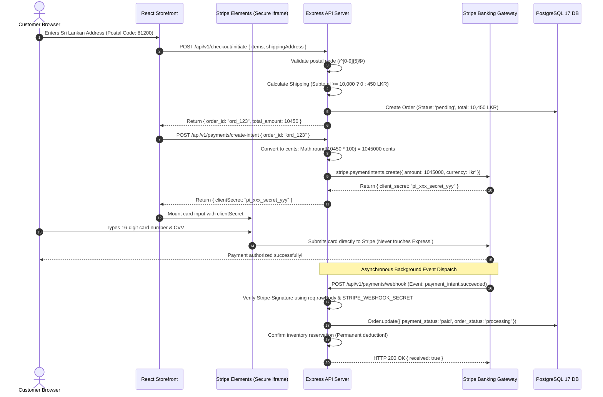

# Part 6: Multi-Step Checkout, Sri Lankan Shipping Logistics & Stripe Payment Gateway

## 🎯 Master Architectural Overview

### The "Why" Question: The Physical Retail Analogy
Imagine finalizing a purchase at the physical checkout desk of **Dickwella Fashion Corner** in Matara:
- **The Courier Logistics Dilemma:** The customer says, *"Please ship this silk saree to my aunt in Dickwella."* The cashier must verify that the 5-digit postal code (`81200` for Dickwella, `81000` for Matara) and recipient phone number are completely valid; otherwise, domestic courier dispatch vans (Domex / Pronto) will drop the box in a return warehouse!
- **The Free Shipping Incentive:** The boutique owner sets a clear promotion: *"If you spend 10,000 LKR or more, your islandwide courier delivery is completely FREE. If your order is under 10,000 LKR, shipping is a flat 450 LKR."* The register must calculate this dynamically as items are added.
- **The Credit Card Security Threat (PCI-DSS):** If the cashier wrote down the customer's 16-digit credit card number and 3-digit CVV code on a notepad behind the counter, a dishonest employee could steal the customer's life savings. In software, if our web server touches or stores raw credit card numbers, we face massive legal penalties and violate **PCI-DSS Level 1** compliance!
- **The Solution:** We use **Stripe Elements**. The customer types their card numbers directly into a secure iframe hosted on Stripe's hardened servers. Our server receives only an encrypted `PaymentIntent` token.
- **The Dropped Wi-Fi Trap (Webhooks):** What if the customer pays on their smartphone, but right as the payment succeeds, they drive into a tunnel and lose cell service? Their browser never gets to show the "Success" screen! To solve this, Stripe's servers send an asynchronous, cryptographically signed **Webhook** directly to our backend server, guaranteeing the order is marked as `paid` even if the customer's phone completely disconnects.

---

### The "What" Question: Core Architecture & Components
In Part 6, we implement an enterprise checkout and billing engine:
- **`checkout.service.js`:** Validates Sri Lankan shipping addresses, generates human-readable invoice identifiers (`DFC-YYYYMMDD-XXXX`), and coordinates the transition from shopping cart to order contract.
- **`stripe.service.js`:** Interfaces with the Stripe REST API. Converts Sri Lankan Rupees into integer cents ($1 \text{ LKR} = 100 \text{ cents}$), binds metadata, and verifies HMAC-SHA256 webhook signatures using raw HTTP buffers (`req.rawBody`).
- **`payment.controller.js`:** Express controller exposing `/api/v1/payments/create-intent` and the `/api/v1/payments/webhook` listener.

---

### The "How" Question: Checkout & Webhook Lifecycle



---

## Sub-Part 6.1: Sri Lankan Postal Validation & Dynamic Shipping Tier Engine

### 1. The Story & The Problem (First-Principles Intuition)
Shipping physical apparel in Sri Lanka has unique regional requirements:
- In the United States, states and 5-digit ZIP codes dictate tax and delivery.
- In Sri Lanka, domestic couriers rely on **5-digit Postal Codes** (e.g. `81200` for Dickwella, `81000` for Matara, `00100` for Colombo 01) and valid 10-digit mobile phone numbers starting with `07` or `+947` for courier SMS delivery alerts.
- **The Average Order Value (AOV) Commercial Engine:**
  - Standard islandwide courier fee is **450 LKR**.
  - To motivate customers to buy an extra accessory or shirt, the store offers **Free Islandwide Shipping** on all orders of **10,000 LKR or more**.
  - If a customer's cart is 8,500 LKR, the checkout UI dynamically shows: *"Add 1,500 LKR more to unlock FREE shipping!"*

---

### 2. Dual-Coding Mental Model: The Shipping Meter Calculation

$$\text{Shipping Fee} = \begin{cases} 0.00 \text{ LKR} & \text{if } \text{subtotal} \ge 10,000.00 \text{ LKR} \text{ or method} = \text{'pickup'} \\ 450.00 \text{ LKR} & \text{if } \text{subtotal} < 10,000.00 \text{ LKR} \end{cases}$$

```
Cart Total: LKR 7,500.00
  ├── Subtotal: LKR 7,500.00 (< 10,000 LKR)
  ├── Shipping: LKR 450.00 [STANDARD COURIER]
  └── Total:    LKR 7,950.00

Customer adds 1 Batik Sarong (LKR 3,000.00):
Cart Total: LKR 10,500.00
  ├── Subtotal: LKR 10,500.00 (>= 10,000 LKR Threshold Reached!)
  ├── Shipping: LKR 0.00 [FREE ISLANDWIDE DELIVERY UNLOCKED!]
  └── Total:    LKR 10,500.00
```

---

### 3. How to Do It: Production Code with Line-by-Line Pedagogical Annotations

#### File: `src/services/checkout.service.js` (Excerpts of Address & Calculation Engine)
```javascript
// ==============================================================================
// Checkout Domain Service - Address Sanitization, Order Creation & Shipping Rules
// Why this file matters: Enforces Sri Lankan shipping validation, applies the
// 10,000 LKR free shipping threshold, and builds the immutable Order contract.
// ==============================================================================

const { Order, OrderItem, ProductVariant, Product, sequelize } = require('../models');
const reservationService = require('./reservation.service');
const ApiError = require('../utils/ApiError');

// Business Rule Constants
const FREE_SHIPPING_THRESHOLD_LKR = 10000.0; // 10,000 LKR
const STANDARD_SHIPPING_FEE_LKR = 450.0;     // 450 LKR flat rate

/**
 * Validates Sri Lankan shipping destination address attributes.
 *
 * @param {object} address - Inbound address object from checkout form
 * @returns {object} Cleaned, standardized address snapshot
 */
const validateShippingAddress = (address) => {
  if (!address || typeof address !== 'object') {
    throw ApiError.badRequest('Shipping address is required');
  }

  const line1 = (address.line1 || address.address_line1 || address.street || '').trim();
  const city = (address.city || '').trim();
  const postalCode = (address.postal_code || address.postalCode || '').trim();
  const district = (address.district || address.state || address.province || '').trim();
  const country = (address.country || 'Sri Lanka').trim();

  // Guard: Mandatory street address
  if (!line1) {
    throw ApiError.badRequest('Shipping address line 1 is required');
  }
  // Guard: Mandatory town / city
  if (!city) {
    throw ApiError.badRequest('Shipping address city is required');
  }

  // [SRI LANKAN POSTAL CODE REGEX VALIDATION]:
  // Sri Lankan postal codes consist of exactly 5 numeric digits (e.g. 81200 for Dickwella)
  const postalRegex = /^[0-9]{5}$/;
  if (!postalCode || !postalRegex.test(postalCode)) {
    throw ApiError.badRequest(
      `Invalid postal code: "${postalCode}". Sri Lankan postal codes must be exactly 5 digits (e.g. 81200).`
    );
  }

  return {
    line1,
    line2: (address.line2 || address.address_line2 || '').trim() || null,
    city,
    district: district || null,
    postal_code: postalCode,
    country,
  };
};

/**
 * Calculates dynamic shipping fee based on order subtotal and fulfillment method.
 *
 * @param {number} subtotal - Garment items sum in LKR
 * @param {string} [method='standard'] - 'standard' or 'pickup'
 * @returns {number} Shipping fee in LKR
 */
const calculateShippingFee = (subtotal, method = 'standard') => {
  // Store pickup at Dickwella boutique is always free
  if (method === 'pickup') {
    return 0.0;
  }
  // Free delivery threshold: Orders >= 10,000 LKR qualify for free shipping!
  if (subtotal >= FREE_SHIPPING_THRESHOLD_LKR) {
    return 0.0;
  }
  return STANDARD_SHIPPING_FEE_LKR;
};

/**
 * Generates an immutable, human-readable sales invoice identifier.
 * Format: DFC-YYYYMMDD-XXXX (e.g. "DFC-20261020-4821")
 */
const generateOrderNumber = () => {
  const dateStr = new Date().toISOString().slice(0, 10).replace(/-/g, '');
  const rand = Math.floor(1000 + Math.random() * 9000);
  return `DFC-${dateStr}-${rand}`;
};

module.exports = {
  validateShippingAddress,
  calculateShippingFee,
  generateOrderNumber,
  FREE_SHIPPING_THRESHOLD_LKR,
  STANDARD_SHIPPING_FEE_LKR,
};
```

---

## Sub-Part 6.2: Stripe PaymentIntent Integration & Currency Cent Mechanics

### 1. The Story & The Problem
When integrating with the Stripe API, junior developers frequently make two critical mistakes:
- **The Floating Point Math Trap:** JavaScript uses IEEE 754 floating-point math. If an order total is `65.10`, writing `65.10 * 100` in JavaScript produces `6510.000000000001`! Passing this to an API that expects an exact integer causes request errors. Always wrap in `Math.round(Number(total) * 100)`.
- **The Smallest Currency Denomination:** Stripe processes **all currencies in their smallest integer unit**. For US Dollars, $10.00 is sent as `1000` (cents). For Sri Lankan Rupees, 6,500 LKR must be submitted as `650000` (cents). Submitting `6500` would accidentally charge the customer only 65 LKR!

---

### 2. Dual-Coding Mental Model: Currency Conversion Pipeline

```
[ PostgreSQL Database ]
Order.total_amount = DECIMAL(10, 2) -> "6500.00" LKR
                          │
                          ▼
             [ JavaScript Conversion ]
   Number("6500.00") = 6500
   Math.round(6500 * 100) = 650000 (Integer Cents)
                          │
                          ▼
            [ Stripe API PaymentIntent ]
   stripe.paymentIntents.create({
     amount: 650000,
     currency: 'lkr',
     metadata: { order_id: "ord_123" }
   })
                          │
                          ▼
          Stripe charges exactly LKR 6,500.00!
```

---

### 3. How to Do It: Production Code with Line-by-Line Pedagogical Annotations

#### File: `src/services/stripe.service.js`
```javascript
// ==============================================================================
// Stripe Payment Gateway Service - Intent Creation & Cryptographic Webhooks
// Why this file matters: Manages PCI-DSS compliant credit card transactions in LKR,
// converts floating-point currency into safe integer cents, and cryptographically
// validates incoming Stripe webhook signatures using raw request buffers.
// ==============================================================================

const crypto = require('crypto');
const Stripe = require('stripe');
const { Order, Payment } = require('../models');
const reservationService = require('./reservation.service');
const orderService = require('./order.service');
const { logger } = require('../config/logger');
const ApiError = require('../utils/ApiError');

// Environment API Keys
const STRIPE_SECRET_KEY =
  process.env.STRIPE_SECRET_KEY || 'sk_test_mock_stackstorm_key_2026';
const STRIPE_WEBHOOK_SECRET =
  process.env.STRIPE_WEBHOOK_SECRET || 'whsec_mock_stackstorm_webhook_secret_key_2026';

// Instantiate Stripe client using pinned API version
const stripe = new Stripe(STRIPE_SECRET_KEY, {
  apiVersion: '2023-10-16',
});

/**
 * Creates a Stripe PaymentIntent for the specified Order in LKR.
 *
 * @param {string} orderId - Order UUID
 * @returns {Promise<object>} PaymentIntent metadata including client_secret
 */
const createPaymentIntent = async (orderId) => {
  if (!orderId) {
    throw ApiError.badRequest('order_id is required to create a payment intent');
  }

  // Load the order from PostgreSQL
  const order = await Order.findByPk(orderId);
  if (!order) {
    throw ApiError.notFound(`Order not found with id: ${orderId}`);
  }

  // [INTEGER CENTS CONVERSION]:
  // Prevents JavaScript IEEE 754 floating-point rounding errors
  const amountInCents = Math.round(Number(order.total_amount) * 100);

  // [CREATE INTENT ON STRIPE SERVERS]:
  const paymentIntent = await stripe.paymentIntents.create({
    amount: amountInCents,
    currency: 'lkr',
    // [AUDIT METADATA]:
    // Attaching our internal order_id allows webhook handlers to identify
    // which order was paid when Stripe sends asynchronous webhook notifications!
    metadata: {
      order_id: String(order.id),
      order_number: String(order.order_number),
    },
    payment_method_types: ['card'],
  });

  // Idempotently create or update the Payment record in our database
  await Payment.findOrCreate({
    where: { order_id: order.id },
    defaults: {
      order_id: order.id,
      payment_method: 'stripe',
      payment_intent_id: paymentIntent.id,
      amount: Number(order.total_amount),
      currency: 'LKR',
      status: 'pending',
      raw_response: paymentIntent,
    },
  });

  return {
    clientSecret: paymentIntent.client_secret,
    paymentIntentId: paymentIntent.id,
    orderId: order.id,
    amount: Number(order.total_amount),
    currency: 'LKR',
    status: paymentIntent.status,
  };
};

/**
 * Cryptographically verifies an incoming Stripe webhook signature.
 * [SECURITY RULE: MUST USE RAW BUFFER]:
 * The payload MUST be the exact, untouched raw Buffer from the HTTP request socket.
 * If Express parsed it into a JavaScript object first, key order or whitespace changes
 * will cause the HMAC-SHA256 signature check to fail!
 *
 * @param {Buffer} rawPayload - Raw binary HTTP request body
 * @param {string} signature - Stripe-Signature header string
 * @returns {object} Verified Stripe event object
 */
const constructWebhookEvent = (rawPayload, signature) => {
  if (!signature) {
    throw ApiError.badRequest('Missing Stripe-Signature header');
  }
  if (!rawPayload) {
    throw ApiError.badRequest('Missing raw webhook payload body');
  }

  try {
    return stripe.webhooks.constructEvent(rawPayload, signature, STRIPE_WEBHOOK_SECRET);
  } catch (err) {
    logger.error(`[STRIPE] Signature verification failed: ${err.message}`);
    throw ApiError.badRequest(`Webhook signature verification failed: ${err.message}`);
  }
};

/**
 * Idempotently processes verified Stripe webhook events.
 *
 * @param {object} event - Verified Stripe event object
 * @returns {Promise<object>} Outcome summary
 */
const handleWebhookEvent = async (event) => {
  const { type, data } = event;
  const paymentIntent = data && data.object;
  const orderId = paymentIntent && paymentIntent.metadata && paymentIntent.metadata.order_id;

  logger.info(`[STRIPE WEBHOOK] Received event: ${type} for orderId: ${orderId}`);

  // [EVENT: PAYMENT SUCCESSFUL]
  if (type === 'payment_intent.succeeded') {
    if (!orderId) {
      logger.warn('[STRIPE WEBHOOK] PaymentIntent succeeded without metadata.order_id');
      return { success: true, processed: false };
    }

    // Step 1: Transition Order status to 'paid' and 'processing'
    await orderService.finalizeOrder(orderId, paymentIntent);

    // Step 2: [PERMANENT INVENTORY CONFIRMATION]:
    // Convert 15-minute temporary reservation into a permanent warehouse stock deduction
    try {
      await reservationService.confirmReservation(orderId);
    } catch (resErr) {
      logger.warn(`[STRIPE WEBHOOK] Reservation confirmation skipped: ${resErr.message}`);
    }

    logger.info(`[STRIPE WEBHOOK] Order ${orderId} successfully marked as PAID`);
    return { success: true, order_id: orderId, status: 'paid' };
  }

  return { success: true, processed: false, ignoredEvent: type };
};

module.exports = {
  createPaymentIntent,
  constructWebhookEvent,
  handleWebhookEvent,
};
```

---

#### File: `src/controllers/payment.controller.js`
```javascript
// ==============================================================================
// Payment Controller - Intent Generation & Webhook Endpoint
// Why this file matters: Serves client payment initiation requests and hosts the
// public webhook listener for asynchronous banking notifications.
// ==============================================================================

const stripeService = require('../services/stripe.service');
const { successResponse } = require('../utils/responseFormatter');
const ApiError = require('../utils/ApiError');

/**
 * Creates Stripe PaymentIntent for order.
 * Client sends { order_id: "..." } and receives { clientSecret: "..." }.
 */
const createPaymentIntent = async (req, res, next) => {
  try {
    const orderId = req.body.order_id || req.body.orderId;
    if (!orderId) {
      throw ApiError.badRequest('order_id is required in request body');
    }

    const result = await stripeService.createPaymentIntent(orderId);
    return successResponse(res, result, 'Payment intent created successfully', 200);
  } catch (error) {
    return next(error);
  }
};

/**
 * Handles incoming Stripe webhooks with cryptographic signature verification.
 */
const handleWebhook = async (req, res, next) => {
  try {
    const signature = req.headers['stripe-signature'];
    if (!signature) {
      throw ApiError.badRequest('Missing stripe-signature header');
    }

    // Extract the raw binary body captured by our express.raw middleware in app.js
    let rawPayload = req.rawBody || req.body;
    if (typeof rawPayload === 'object' && !Buffer.isBuffer(rawPayload)) {
      rawPayload = Buffer.from(JSON.stringify(rawPayload));
    }

    const event = stripeService.constructWebhookEvent(rawPayload, signature);
    const result = await stripeService.handleWebhookEvent(event);

    // Return HTTP 200 to Stripe immediately so Stripe stops retrying the webhook
    return res.status(200).json({ received: true, ...result });
  } catch (error) {
    return next(error);
  }
};

module.exports = {
  createPaymentIntent,
  handleWebhook,
};
```

---

### 4. Alternative Approaches & Decision Reasoning

| Criterion | Stripe Elements + Webhooks (Chosen) | Hosted Stripe Checkout Redirect | Direct Card Collection on Server |
|---|---|---|---|
| **Branded Experience** | 100% embedded in Dickwella Fashion Corner boutique design; zero redirects. | Redirects customer away to `checkout.stripe.com`, breaking brand immersion. | Disastrous: Extreme security liability; violates PCI-DSS regulations. |
| **Reliability** | Webhooks guarantee order transitions to 'paid' even if customer battery dies. | Fails if user closes browser during redirect back. | High risk of failed manual charges. |
| **PCI Scope** | SAQ A-EP (lowest audit burden; card inputs rendered in Stripe iframes). | SAQ A. | SAQ D (requires full on-site security compliance audits). |

---

### 5. Multi-Channel Verification Blueprint

```bash
# CHANNEL 1: Validate Sri Lankan Address via cURL
curl -i -X POST http://localhost:5000/api/v1/checkout/validate-address \
  -H "Content-Type: application/json" \
  -d '{
    "full_name": "Kavindu Perera",
    "address_line1": "No. 42 Main Beach Road",
    "city": "Dickwella",
    "postal_code": "81200",
    "phone": "0771234567"
  }'
# EXPECTED: HTTP 200 OK

# CHANNEL 2: Trigger Simulated Stripe Webhook via Stripe CLI
stripe listen --forward-to localhost:5000/api/v1/payments/webhook
stripe trigger payment_intent.succeeded
# EXPECTED LOG:
# [STRIPE WEBHOOK] Order ord_... successfully marked as PAID
```

---

### 6. Beginner Pitfalls & Self-Explanation Prompts
> **Self-Explanation Challenge:**  
> *Ask yourself:* What would happen if our webhook listener did NOT check whether an order was already marked as `paid` before processing `payment_intent.succeeded`?  
> **The Reality:** **Duplicate execution bugs!** Stripe's webhook delivery system guarantees *at-least-once delivery*. If our server takes 3.1 seconds to respond and Stripe's timeout is 3.0 seconds, Stripe will immediately send the exact same webhook a second time! Without an idempotency check (`if (order.payment_status === 'paid') return;`), our server would decrement warehouse stock a second time, corrupting inventory counts!
